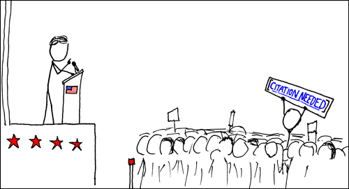

  
xkcd 285, Wikipedian Protester

  

    
  

<a href="https://xkcd.com/285/">xkcd 285</a>, Randall Munroe, CC BY-NC 2.5.

An agent's memory file is a page of uncited claims, and its one reader is the agent's next session. Anthropic's post on [the components of agent memory](https://www.anthropic.com/research/components-of-agent-memory), published on November 6, says what happens to a wrong claim: a later session reads it and trusts it.

So when Mads Thines argued on November 7 that [agent memory needs its OpenTelemetry moment](https://www.lorekit.io/blog/open-agent-memory-format), I read it looking for the citation field. He has it, and he leaves it optional, which is the one thing in his proposal for [AI agent memory](/articles/agent-memory/) I'd change.

## What I make of the proposal

I like the problem Thines starts from, and I think his five questions are the right ones for moving a memory between tools. His coding tools each keep what they remember where the others can't read it, and he wants what observability got in 2019: an agreed data model, here covering everything from where a memory is true to which version is current.

He's fair to his critics, printing the objection that a trace is written once and a memory gets corrected, and he gets close to my point more than once. He wants a record to say who wrote it and he praises GitHub's Copilot Memory for pairing citations with forgetting, but he leaves the idea as an open question: "Should a record point at the code it depends on?"

## The question I'd add

My answer is yes, and I'd make it required. None of his five questions asks how the writer knew, so a record can say where it applies and when it expires and still be wrong.

Is there evidence that such a field does the work? Only a hint, and it comes from the Anthropic post.

On a benchmark where models built their own notes across sessions, Claude Opus 5 was the first of the models tested whose entries carried a rule along with how it knew the rule was true. That describes what a stronger model wrote, and the post doesn't test the clause in isolation, so I won't claim it does.

Then there's the note Anthropic quotes from a model playing Pokémon, a rule for what to do after several failed throws: "VARY the timing (insert extra 'wait' presses between menu steps) - the catch landed right after doing this."

To me the last clause of that note is a citation. A later session reading it knows the rule came from one success, and can weigh it as that.

The post's failure case is a note with no source. A model recorded a landmark on the wrong side of a mountain and kept acting on it, and in a separate run a pass that checked the note against the session log caught the error.

## Why I'd settle trust before format

I don't think a shared format is the urgent part, and the commenters on [the Hacker News thread](https://news.ycombinator.com/item?id=50411467) made that case well. A commenter argued that a spec matters less here because the reader is an agent, which can already read files in any shape.

Another had given up on memory as a feature: "it remembers the wrong things, and then turns them into an inane focus for each task." I read that as a complaint about trust, and a shared format would deliver the same wrong things to more tools.

Thines half agrees, since his draft record has room for a pull request number among its optional attributes. And a shipped product already goes further: Copilot Memory, in his own table, stores facts with code citations and deletes them after 28 days unused.

So optional is the part I'd change. A record with no source should be readable as a guess, the way an untagged sentence on Wikipedia is readable as unchallenged, and a model should be told the difference.

## What a sourced note looks like

A sourced note needs little. It says what was observed, where, and when: the command and its output, the file and line, or the turn of the session in which the user said it.

I hold a documentation page to that standard, and the reason is the same. A reader who can check a claim doesn't have to trust the writer, and for an agent the writer is an earlier session that can't be asked.

An open project already enforces part of this in code, and my page on [DeerFlow's memory](/articles/deerflow-memory/) covers its rule that only evidence from the user counts as confirmation.

My page on [memory serialization](/articles/memory-serialization/) keeps the log beside the record for this reason, and [memory versioning](/articles/memory-versioning/) covers what to keep when a note is corrected. A shared format would be worth having once the notes inside it can be checked.
