An agentic workflow is a multi-step process that an AI agent plans and carries out with tools, deciding each next step from the last result. For coding work, the agentic workflow I'd run puts a person at two points: a person writes down what done means before the agent starts, and a person approves the result before it merges.

On November 4 someone asked Hacker News [what everyone's agentic setup looks like](https://news.ycombinator.com/item?id=50366117), and several hundred people answered. The people who answered disagree about which model to use, which harness to run it in and whether to sandbox the agent at all.

The answers agree on one practice, and it's the useful part of the thread. A top reply, from someone who had thrown out their custom skills, put it this way: "the biggest trick is just to tell it what complete looks like."

So this page covers the steps of a workflow that stay the same whichever model or harness you use, as those steps apply to [coding agents](/articles/coding-agents/).

<figure class="np-figure">
  <a class="np-figure-zoom" href="/static/images/diagrams/agentic-workflows/workflow-pipeline.svg"><picture><source media="(max-width: 712px)" srcset="/static/images/diagrams/agentic-workflows/workflow-pipeline.narrow.svg" width="288" height="776"></picture></a>
  <figcaption>A person frames the task and reviews the diff, the agent does the run, and the person and the agent share scoping and landing.</figcaption>
</figure>

## What is an agentic workflow?

An agentic workflow is the process around an agent run, and the run itself is a separate thing. The agent's own cycle of model call and tool call is [the agent loop](/articles/agent-loop-anatomy/), and a workflow is the set of steps a person adds before and after that loop.

For a coding task the workflow starts at a prompt and ends at a merged pull request. I split the workflow into five stages, and a person owns the first stage, framing, and the fourth, review.

## What are the five stages?

The five stages are frame, scope, run, review and land. Anthropic's [best practices for Claude Code](https://code.claude.com/docs/en/best-practices) list five questions to ask before a run goes unattended, and my five stages match Anthropic's five questions closely enough that the table sets them side by side.

| Stage | Who | What it settles | Anthropic's question |
| --- | --- | --- | --- |
| Frame | You | What done means | Does it know what done looks like? |
| Scope | You | Which files and how large a change | What's it allowed to touch? |
| Run | The agent | The work, with its own checks | Can it check its own work, and what stops it? |
| Review | You | Whether the diff does what the frame asked | Who signs off? |
| Land | The agent drafts, you approve | The commit and the pull request | Where does the result go? |

Anthropic's page ends its list by naming the decisions that stay with a person: starting the run, deciding what done means for this task, and approving the merge at the end. I'd keep each of those decisions with a person in any agent setup.

## How do you frame a task for an agent?

Frame a task by writing down what done looks like before the agent sees the task. A frame answers what the change is, how you'll know it worked and what must not break.

Say the request is "add caching to the API". "Add caching" could mean an in-memory layer or HTTP cache headers, and an agent given only that one line will pick one of the two meanings and build on it.

So I'd put the frame in a short written brief: the goal, an acceptance check, the hard constraints and the files you expect to change. Anthropic's version of the acceptance check is a goal condition or a failing test the agent has to turn green.

Rules that hold for every task, such as "use pnpm", don't belong in a task brief. Those rules go in the instruction file the agent loads at the start of each session, which my [CLAUDE.md guide](/articles/claude-md/) covers.

## How big should one agent task be?

A single agent task should be small enough that you can read its whole diff in one sitting. An agent will change forty files if the task allows it, and nobody reviews a forty-file diff line by line.

When the task is larger than that, split it into changes that each stand alone, each with its own frame and its own review. A sequence of small changes reaches the same large change, and you can check each step along the way.

Scoping is also where you decide how many agents the task needs, and my answer is nearly always one agent. The costs of adding a second agent are covered in [multi-agent vs single-agent systems](/articles/multi-agent-vs-single-agent/).

## What should an agent run leave behind?

An agent run should leave behind a record you can read afterwards, with evidence for every claim the agent makes. Anthropic's advice is to ask for the command the agent ran and its output, because a bare "all tests pass" tells you very little.

A run's limits should be set in the same layer that keeps the record. A turn limit and a spending limit stop a run that isn't getting anywhere, and the [agent harness](/articles/agent-harnesses/) is the layer that enforces both.

A side task, such as searching the codebase for every caller of a function, doesn't have to fill the main context window. A [Claude Code subagent](/articles/claude-code-subagents/) does its searching in its own window and hands back the answer.

## Why review the diff and not the summary?

Review the diff because the summary reports what the agent believes it did, and the diff shows what it did. A summary that says "fixed the failing test" reads the same whether the agent fixed the bug or deleted the assertion.

I'd read for the changes nobody asked for: a config flag flipped, an error swallowed, an assertion deleted so a test goes green. No tool flags a flipped flag, a swallowed error or a deleted assertion, and each of them passes every automated check the agent ran.

Anthropic's docs suggest one more reader, a review by a fresh subagent that never saw the conversation and so isn't swayed by the reasoning that produced the code. I think a fresh subagent is a good second reviewer and a poor substitute for your own review.

Every step above assumes a person still has attention to spend on review. [My essay on a build that is always red](/articles/red-build-nobody-reads/) looks at what happens when agents produce more signals than a team can read.

## How do you land the change?

Land the change by reusing the frame from stage one. The acceptance check you wrote in stage one becomes the pull request description, so the reviewer checks the change against the acceptance check you wrote before the run.

Let the agent draft the commit message and the description from the diff, then edit them against what the diff does. A person approves the merge, because a merge to the main branch is hard to take back.

## FAQ

**What is an agentic workflow?**

An agentic workflow is a multi-step process that an AI agent plans and carries out with tools. The workflow on this page puts a person's statement of what done means before it and a person's approval after it.

**Do I need a stronger model for an agentic workflow?**

A stronger model finishes more in one pass. The frame and the review catch mistakes from any model, so both steps matter whichever model you run.

**How big should a single agent task be?**

Small enough that you can review the whole diff in one sitting. Split anything larger into changes that each stand alone.

**Should I use several agents for one feature?**

Nearly always no. A second agent adds coordination, and one agent with a clear frame and a reviewed diff is the simpler setup to trust.
