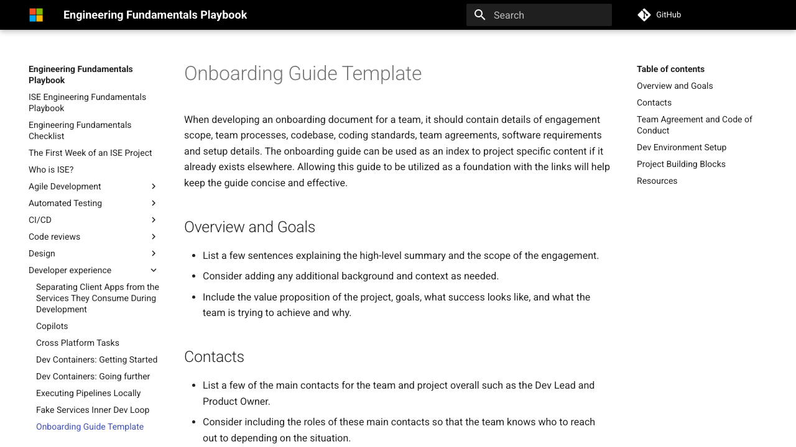
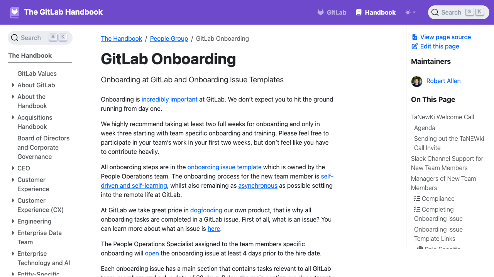

Jeff Atwood published a badge in 2007 for software that had passed the [Works on My Machine certification program](https://blog.codinghorror.com/the-works-on-my-machine-certification-program/). A new engineer's first week is when a team finds out how much of its setup has only that certificate.

Developer onboarding documentation takes a new engineer from a clean machine to a safe first merged change, with one supported setup path and a check after each step. I'd end the guide at the merge, because a reading list gives the reader no finish line to reach.

Say a new engineer on day two asks which Node version to use, whether Docker is required and where the test credentials live. Suppose the first answer is in the README, the second is in a Slack thread and the third is an assumption inside the setup script.

A teammate can walk the new engineer through all of it, and the machine will run by the afternoon. The onboarding guide is still wrong after that rescue, because it claims the setup is documented when part of the setup lives in one person's head.

My rule for this kind of [technical documentation](/articles/technical-documentation/) is that the guide alone has to carry someone from a clean machine through setup, review and a verified change in a test environment.

## Where should developer onboarding documentation end?

Developer onboarding documentation should end at the new engineer's first merged change.

"Learn the codebase" has no finish line. "Run the product, change one behavior, pass the checks, open a pull request and verify the merged result" names five things a reviewer can check.

A team may put architecture first because it wants the new engineer to understand the system before touching it. I'd reverse the order, because a diagram of the request flow makes more sense after the reader has sent one request through it.

### State the result before the setup begins

Put a completion checklist near the top of the page, written so that a reviewer can test each line. The checklist below is an illustration and names no real product:

```text
Onboarding route complete when:
[ ] The API and database run locally.
[ ] GET /health returns 200 and the current commit SHA.
[ ] The starter test fails before the change and passes after it.
[ ] CI passes on the pull request.
[ ] The change appears in the test environment.
```

Replace any line that says "understand the architecture" or "explore the repository" with something the reader can show, such as a passing test. The architecture pages become links that a step points to when the step needs them.

### Put a check after each stage

A command that exits without an error has only shown that it exited. The database can still be unhealthy, and the API can still be pointed at the wrong environment.

The block below uses placeholder ports and illustrative commands:

```text
Database ready:  docker compose ps --format json
API ready:       curl --fail http://localhost:8080/health
Tests ready:     npm test
Frontend ready:  open http://localhost:3000
```

Write the expected output next to each check. If the `curl` command returns anything other than `200`, the reader stops and goes to the recovery steps for the API, so that step six isn't where they discover that step two never worked.

## How many setup paths should the guide offer?

The guide should offer one setup path, the path the team tests. Setup pages collect alternatives over time: a bootstrap script that one person uses, a Docker setup that another prefers, and an old wiki page that still shows up in internal search.

Calling that pile "flexible" hands the choice to the new engineer, who is the person with the least information to choose with. Pick one path and mark it as supported, if Windows needs different commands, give them their own heading, and move the old commands off the page.

### Name versions and access before a command needs them

"Install Node" isn't an instruction. Name the file that holds the version, the command that checks it and the first step that depends on it.

[Corepack's README](https://github.com/nodejs/corepack/blob/main/README.md) describes one way to pin a package manager: you set the `packageManager` field in `package.json`, and `corepack enable` puts the matching Yarn and pnpm binaries on your path.

The table below is an illustration. The version `pnpm@10.17.1`, the vault role and the recovery commands are placeholders and not facts about any repository.

| Dependency | Source of truth | Check | Failure branch |
| --- | --- | --- | --- |
| Node.js | `.node-version` | `node --version` | Run the repository's version-manager command |
| Package manager | `"packageManager": "pnpm@10.17.1"` in `package.json` | `pnpm --version` prints `10.17.1` | In a Corepack-managed repository, run `corepack enable pnpm` and `corepack install`; otherwise use the repository's documented installer |
| Test secrets | Test-vault role | `vault token lookup` | Request the role before cloning private fixtures |
| Local services | `compose.yaml` | `docker compose config --quiet` | Fix missing variables before starting containers |

Before you publish the setup path, replace every "ask the team" with a file or a command the reader can check alone.

Microsoft's [onboarding guide template](https://microsoft.github.io/code-with-engineering-playbook/developer-experience/onboarding-guide-template/) keeps setup separate from contacts, team agreements and project building blocks. It also says the guide can be "an index to project specific content if it already exists elsewhere", which is the right limit: the guide links to the handbook and doesn't copy it.

<div class="visual-wrapper">
  <div class="visual-title">Microsoft's onboarding guide template</div>
  <div class="visual-container">
    
  </div>
</div>
<p class="visual-caption">Microsoft's template gives setup its own section, apart from contacts, team agreements and project building blocks.</p>

### Put the fix beside the step that fails

"Ask in Slack if you get stuck" helps the author more than the reader. Next to each command that can fail, put the symptom, the command that diagnoses it, the supported fix and the person or channel to escalate to.

The service name, port, environment variable and channel below are invented for the example:

```text
Symptom: checkout-db is unhealthy
Check:   docker compose logs checkout-db --tail=50
Cause:   Port 5432 is already used by a local PostgreSQL service
Fix:     Stop the local service or set CHECKOUT_DB_PORT=5433
Verify:  docker compose ps checkout-db
Escalate: Post the command and full output in #dev-help
```

Replace "restart everything" with the specific thing to stop or reset, the fix, and a command that proves the fix worked. Put a real channel or owner in the escalation line before the guide ships.

## What should a new engineer's first change be?

The first change should be real, small and reversible, because its job is to take the new engineer through the team's actual branch, test, review and deploy steps.

GitLab's public [onboarding handbook](https://handbook.gitlab.com/handbook/people-group/general-onboarding/) runs onboarding as tasks in a GitLab issue, and each onboarding issue has a due date of 30 days. GitLab's process covers a whole company, and the part I'd copy for a first engineering change is that each onboarding task sits in an issue with a due date, so anyone can see what is done.

<div class="visual-wrapper">
  <div class="visual-title">GitLab's public onboarding handbook</div>
  <div class="visual-container">
    
  </div>
</div>
<p class="visual-caption">GitLab's handbook runs onboarding as tasks in an issue with a 30-day due date.</p>

### Choose a change that is real and reversible

A good first issue goes through the normal branch, test, review and deploy steps without touching production data or credentials. I'd accept an issue as a first change only if all five of these hold:

- The change affects behavior the engineer can see, such as a response.
- A failing test can describe the starting state.
- The change stays inside one component with a named owner.
- The test environment can prove the result.
- Reverting the merge restores the earlier behavior.

An issue that needs production data, spans several services or has no reliable test fails as an onboarding task, even if the code change is ten lines.

### Introduce the architecture after the first request

Show the reader the path of the request they just sent. The chain below is an illustration and not a claim about any system:

```text
Browser -> API gateway -> authentication -> checkout service -> database
```

Link each component in the chain to its repository, its local run command and its owner. The full platform diagram can wait until the engineer has a request, a log line and a code path to place on it.

## How do you keep onboarding documentation current?

Change the guide in the same merge request as the setup change that makes it wrong. An onboarding guide goes stale when setup changes are reviewed in one place and the guide is edited in another.

GitLab's [documentation workflow](https://docs.gitlab.com/development/documentation/workflow/) says its technical writing team "strongly encourages including documentation in the same merge request as the code that it relates to". Microsoft's [repository guidance](https://microsoft.github.io/code-with-engineering-playbook/documentation/guidance/project-and-repositories/) likewise lists onboarding and setup among the documentation that belongs to a repository.

### Assign an owner where the change happens

Record an owner and a review trigger for each stage of the route. The teams in this table are illustrative, so use the teams that control each fact in your company:

| Stage | Owner | Review trigger |
| --- | --- | --- |
| Access | Platform team | Role or vault-policy change |
| Local setup | Service maintainer | Runtime, dependency, or container change |
| Starter issue | Product team | Workflow or test-harness change |
| Pull request | Repository maintainer | CI or review-policy change |
| Test deployment | Release owner | Environment or release-process change |

A single person can own the whole guide. A generic "docs owner" still can't verify a vault policy or a CI rule that another team controls, so name the team that owns each fact next to its stage.

### Rerun the route from a clean machine

A clean container catches a missing package. It can't request a real permission or notice that two pages disagree about the supported workflow, so I'd automate the setup commands and have a person review the decisions around them.

The block below uses the reserved `example.com` domain, a fictional `checkout-api` repository and a placeholder port. Don't copy it as a working setup:

```bash
git clone https://example.com/checkout-api.git
cd checkout-api
mise install
docker compose up --detach
npm test
curl --fail http://localhost:8080/health
```

If your real run needs a globally installed package, a cached credential or an instruction that isn't on the page, fix the page before you call the route passing.

## What does a complete onboarding route look like?

The route below is for Orbit, a checkout API I made up for this page. It isn't a client project and it carries no measured result.

A weak onboarding issue for Orbit would say: "Read the architecture overview, clone the repositories, set up the services, and choose a starter ticket." Each of those four instructions leaves a decision to the new engineer, such as which repository to clone first and which ticket is safe.

### Replace the reading list with a route

| Stage | Instruction | Evidence |
| --- | --- | --- |
| Access | Join `checkout-dev` and request the test-vault role | The test secret is visible |
| Repository | Clone `checkout-api` and run `mise install` | `node --version` matches `.node-version` |
| Services | Run `docker compose up db redis` | Both services report `healthy` |
| API | Run `npm run dev`, then call `/health` | The response contains the current commit SHA |
| First request | Create a test checkout with the sample token | The response returns a checkout ID |
| First change | Reject an empty `customer_reference` | The new test fails, then passes after the change |
| Review | Open a pull request with the onboarding label | CI passes and the component owner reviews it |
| Deploy | Merge and call the test API | The validation error appears in the test environment |

The route teaches Orbit through the same steps the team uses to ship. Every cell in the evidence column is something a reviewer can look at, such as a response or a test result.

### Record where readers needed a rescue

After someone follows the route, write down each stage where they needed a choice the page didn't make or help from a teammate.

| Observed failure | Documentation decision |
| --- | --- |
| Setup stalls because the vault role wasn't requested first | Move access before the repository step |
| The health check passes against the wrong build | Return the commit SHA in the response |
| Starter issues cross component boundaries | Accept a starter issue only if it stays in one owned component and its merge can be reverted |
| Review waits with no assignee | Name the reviewer in the onboarding issue |

Each failure in the left column leads to one change in the route. Page views can't show you that the vault role was requested too late, and a note from the person who ran the route can.

## Developer onboarding docs checklist

- The route ends in one safe merged change through the normal delivery workflow.
- A single supported setup path lists its prerequisites before its commands.
- Each stage that can fail has a check, a fix and an escalation contact.
- Each stage names the team that owns its facts and the change that triggers a review.
- A run from a clean machine reproduces the documented path.

The guide to [what technical documentation should include](/articles/technical-docs/) covers the pages a product needs besides onboarding. A product's quickstart needs the same single setup path, and writing quickstarts is work I take on, described under [developer documentation](/services/developer-documentation/).

Before the route ships, run it through the [documentation review checklist](/articles/documentation-review/), which tests the commands and the rendered page.

## FAQ

**What should developer onboarding documentation include?**

It should include the access a new engineer needs, one supported setup path with a check after each stage, a first change to make, and the fix for each step that can fail. It should end when that first change is merged and verified.

**How long should developer onboarding take?**

This page doesn't give a number, because I haven't measured one. Record how long each stage takes the next new engineer and where they needed help, and shorten the stage that took longest.

**Should the onboarding guide explain the architecture?**

It should link to the architecture, after the reader has sent a first request through the system. A new engineer places a diagram better once they have a request and a log line to match against it.

**Who should own developer onboarding documentation?**

Each stage should be owned by the team that controls its facts. The platform team owns access, for example, and the service's maintainers own local setup.
