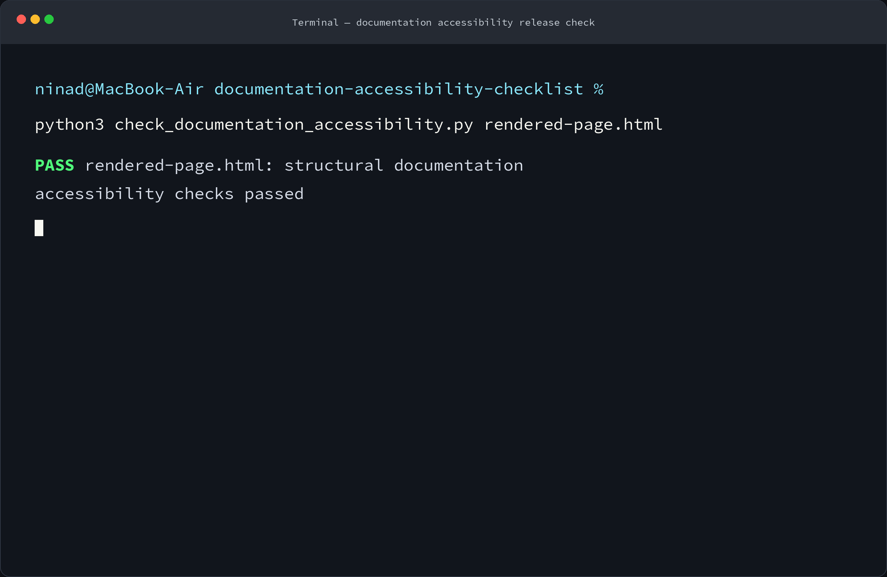

Documentation accessibility is whether a reader can finish the page's task with a screen reader, a keyboard or a zoomed-in browser. A page can look finished and still fail that reader, for example when a link is named "here" or a screenshot is the only place that shows the request succeeded.

A quick first test is to open the page in [Lynx](https://en.wikipedia.org/wiki/Lynx_(web_browser)), the text-only browser that has been maintained since 1992, which shows the page without its stylesheet. A heading that was only bold text becomes a plain line, and an image becomes its alt text or nothing.

The checklist below is the one I'd run before a docs release, and it sits with my other guides to [technical documentation](/articles/technical-documentation/). A small [checker script](/static/downloads/documentation-accessibility-checker.zip) covers the checks a parser can do, and the rest need a person.

## What should a documentation accessibility checklist cover?

A documentation accessibility checklist should cover six page elements, checked against the generated HTML and the rendered page:

| Page element | What a screen-reader or keyboard user needs from it | Quick check |
| --- | --- | --- |
| Heading | Section structure | One page title, ordered heading levels, and no headings created only with visual styling |
| Code | Copyable instructions | Actual text, a declared language, a starting state, and an observable result near the command |
| Link | Where the link goes and what it does | Link text names the destination and signals a download, new tab, or same-page jump when that behavior matters |
| Table | Which header each value belongs to | A simple data table has headers, and layout is not built with table markup |
| Visual | The image's information as text | Meaningful images have useful alternatives, decorative images have empty alternatives, and complex visuals have nearby equivalent detail |
| Rendered page | Keyboard and zoom use | Focus remains visible, interactive controls work from a keyboard, and reflow does not hide the task |

<p><a class="btn btn-primary" href="/static/downloads/documentation-accessibility-checker.zip" download>Download the documentation accessibility checker (.zip)</a></p>

The script checks six things: exactly one `h1`, images without an `alt` attribute, vague link text, skipped heading levels, tables without header cells, and code blocks without a language class. Keyboard use, contrast and screen-reader output are outside what it can test.

## How do you test headings, lists and tables?

Test them in the HTML, because a screen reader follows the markup and not the styling. [Google's accessibility guidance](https://developers.google.com/style/accessibility) for developer docs says "Don't skip levels of the heading hierarchy", and tells writers to change a heading's look with CSS instead of picking a different level.

### Use headings to show the order of the task

Keep one page title, then use heading levels to lay out the task in the order a reader does it. Read the headings alone, without their paragraphs, and check that they tell you where to start, what to do next and where to confirm it worked.

The same headings-only test is in my [SEO checklist for documentation sites](/articles/docs-seo/), because a visitor from search reads the headings to decide whether the page answers them.

### Keep lists and tables semantic

Use a list when several items belong together, and a table only when readers need to compare the same fields across rows. A data table needs header cells, and a table used to lay out the page makes a screen reader announce rows and columns that mean nothing.

Michigan State University's [basic accessibility checklist](https://webaccess.msu.edu/tutorials/basics/checklist) recommends simple tables with column and row headers. If you can't name the headers for a table, split it into two tables or turn it into a list.

## How do you test code blocks and links?

Check that each command is real text with a declared language, and that each link's text names where it goes. A code block is something the reader operates: they copy it, run it and compare the result.

### Put commands in text and name their language

Never put a command in a screenshot. Google's guidance says "Don't use images of text, code samples, or terminal output", and the MSU checklist's reason is that real text is "searchable, selectable, and recognized by assistive technologies", and an image of a terminal is none of those.

Declare the language on the code fence, so the generated HTML carries a class such as `language-bash`. Put the prerequisites and the expected output in the text next to the block, where a screen reader will reach them.

### Give links text that names the destination

Some screen-reader users scan a page by jumping from link to link. Google's guidance says links "should make sense when read out of context", so "click here" fails and "read the documentation review checklist" passes.

When a link starts a download, jumps within the page or opens a new tab, say so in the link text.

## How do you make images accessible in documentation?

Write alt text that gives the information the image is there to give. If a screenshot shows that a request returned `200`, the alt text should say that the request returned `200`, and the response should also appear as text near the image.

[Open edX's accessibility checklist](https://docs.openedx.org/en/latest/educators/references/accessibility/accessibility_best_practices_checklist.html) sets the rule by the kind of image. A simple image gets alt text, a graph gets its information as text next to it, and a purely decorative image gets an empty `alt` so a screen reader skips it.

A red error box also has to say in words that the request failed, because color can't be the only way a reader learns the status.

The [WCAG 2.2 Quick Reference](https://www.w3.org/WAI/WCAG22/quickref/) lists the success criteria behind each of these checks, including text alternatives, contrast and keyboard operation. It's the place to look up a criterion, and the page's real task still has to be tested by hand.

## What can an accessibility checker find, and what can't it?

A checker can find markup that is missing, and it can't tell whether the page is usable. To show both sides, I wrote a short page with five mistakes in it and saved it as `bad.html`:

```html
<!doctype html>
<html lang="en"><head><title>Create an API key</title></head><body>
<h1>Create an API key</h1>
<h3>Run the command</h3>
<p>Copy the command from <a href="/docs/keys">here</a>.</p>
<pre><code>acme keys create --name ci</code></pre>

<table><tr><td>Plan</td><td>Keys</td></tr><tr><td>Free</td><td>2</td></tr></table>
</body></html>
```

Then I fixed all five and saved the result as `good.html`:

```html
<!doctype html>
<html lang="en"><head><title>Create an API key</title></head><body>
<h1>Create an API key</h1>
<h2>Run the command</h2>
<p>Copy the command from the <a href="/docs/keys">API keys reference</a>.</p>
<pre><code class="language-bash">acme keys create --name ci</code></pre>

<table><tr><th>Plan</th><th>Keys</th></tr><tr><td>Free</td><td>2</td></tr></table>
</body></html>
```

Running the checker on both files on November 18, 2026 printed this:

```text
$ python3 check_documentation_accessibility.py bad.html
FAIL bad.html
- link text is too vague: 'here'
- code block has no declared language class
- image is missing an alt attribute
- heading level jumps from h1 to h3
- table 1 has no th header cells
exit code: 1
$ python3 check_documentation_accessibility.py good.html
PASS good.html: structural documentation accessibility checks passed
exit code: 0
```

The checker named each of the five mistakes on the first file and exited with code 1, which is what lets a build step fail on it. The screenshot below is from an earlier run of the same script.

<div class="visual-wrapper">
  <div class="visual-title">Documentation accessibility checker on the repaired fixture</div>
  <div class="visual-container">
    
  </div>
</div>
<p class="visual-caption">An earlier run of the checker passing a repaired page.</p>

Run the checker on the generated HTML and not on the Markdown source. Plugins, templates and syntax highlighters all change the markup between the two, and the generated page is what a reader's screen reader receives.

### Test with a keyboard and with zoom

Start at the browser's address bar and press Tab through the page. The focused control should stay visible, every link and button should work without a mouse, and the focus should move in reading order.

Then zoom the page to 200% and check that the task is still readable without scrolling sideways, and listen to the page with a screen reader if you have one. The [documentation review checklist](/articles/documentation-review/) covers the rest of a release review, including links and metadata.

## How do you make accessibility part of a docs release?

Run the checker in the same preview step that already validates links and examples, and block the release when it fails. The manual tests go on the release checklist, with a named owner for each page template.

I'd start with one task page, such as the page for creating an API key. Fix its headings, its code block and its images.

A fix made in the template, such as the language class on code blocks, carries to every page built from it. Writing docs that pass these checks is work I take on, described under [developer documentation](/services/developer-documentation/).

## FAQ

**What is documentation accessibility?**

Documentation accessibility means a reader can complete the page's task with a screen reader, a keyboard or a zoomed browser. It depends on the page's HTML structure as well as on how the page looks.

**Can accessibility testing be automated?**

Part of it can. A script can find missing alt text, vague link text, skipped heading levels and tables without headers, and a person has to test keyboard focus, zoom and screen-reader output.

**Should code samples be images?**

No. A command in an image can't be copied, searched or read by a screen reader, so put every command in a text code block.

**Which accessibility standard applies to documentation?**

WCAG 2.2 is the reference this checklist follows. Its Quick Reference lists the success criteria for text alternatives, contrast, keyboard operation and link purpose.
