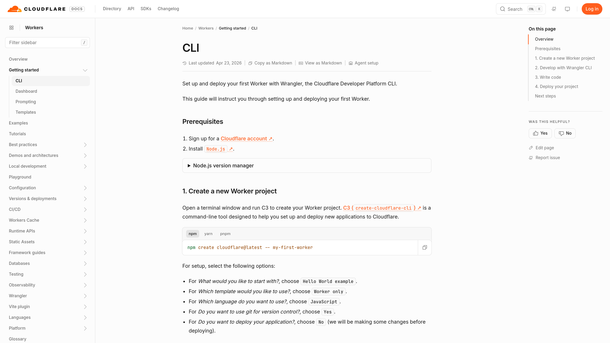

Every developer has used View Source to find out what a page is really made of. SEO for documentation starts there too: View Source shows the HTML exactly as the server sent it, which is the HTML a crawler reads, and the page a browser renders after running JavaScript can hide what that HTML is missing.

SEO for documentation is the work of making sure a docs page can be found, read and chosen by a search engine for the task it documents. I treat it as a chain: one page owns each task, a crawler can reach that page through a plain link, the source HTML holds the content, and the canonical tag, the sitemap and the internal links all name one URL.

A page with a perfect title does nothing for you while a duplicate outranks it or its canonical points somewhere else. So this checklist for [technical documentation](/articles/technical-documentation/) runs in dependency order and stops at the first blocking failure.

I built a small audit script for the source-level checks and reran it this week against Cloudflare's Workers CLI guide. The output is further down, along with what the script can't see.

## What does SEO for documentation need to check?

SEO for documentation needs to check seven areas, and a failure in one area blocks the areas listed after it:

| Area | Question | Blocking evidence |
|---|---|---|
| Search intent | Does this page own one developer task? | Another page already answers the same query better |
| Discovery | Can a crawler reach the URL through links? | No crawlable internal link from an indexable page |
| Crawling | Can the server return the page and its required resources? | Blocked URL, redirect loop, repeated `5xx`, inaccessible HTML |
| Indexing | Is the page eligible for search? | `noindex`, soft 404, duplicate without a clear canonical |
| Canonicalization | Do all URL signals identify the same page? | Canonical, sitemap, redirect, and internal links disagree |
| Page quality | Can the reader identify and complete the task? | Generic title, stale version, missing prerequisites, broken example |
| Measurement | Can the team see what happened after release? | No baseline, change annotation, or page owner |

## How do you audit a documentation page for SEO?

Work through these eight steps in order, and fix the first blocking failure before moving to the next one. The eight steps cover the seven areas in the table, with the audit script as a step of its own, and I've put search intent first because a page that shouldn't exist makes the other checks pointless.

### Step 1. Search intent and page ownership

Start with page ownership, because a developer's search names a task, an error or a version, as in `stripe 401 invalid api key`. The page that owns that query should name the task and show what success looks like.

| Search | Page that should own it | Successful outcome |
|---|---|---|
| `cloudflare workers deploy` | Deployment guide | A Worker reaches a live URL |
| `stripe 401 invalid api key` | Authentication troubleshooting page | The request succeeds after the cause is fixed |
| `kubectl logs flags` | Command reference | The reader chooses and runs the correct flag |
| `oauth refresh token expiry` | Concept plus implementation guide | The application renews access safely |
| `migrate sdk v2 to v3` | Versioned migration guide | The application runs on the supported version |

If two pages complete the same task, find every page that answers it before writing anything new. I look in the docs, the marketing site and the support center, then in the changelog and older doc versions.

Then I pick one page to own the task, move the useful material from the weaker page into it, and redirect the weaker page. The [documentation organization guide](/articles/documentation-structure/) covers that consolidation work in detail.

### Step 2. Internal links and XML sitemaps

Google's [SEO Starter Guide](https://developers.google.com/search/docs/fundamentals/seo-starter-guide) says Google primarily finds pages through links from pages it has already crawled. So I check that every important docs URL has a link from a hub, a guide or a sibling page, and I don't rely on its sitemap entry alone.

The link has to help a person too: it should lead to a prerequisite, a deeper explanation or the next task.

#### Crawlable internal links

Google's [crawlable-link guidance](https://developers.google.com/search/docs/crawling-indexing/links-crawlable) says Google can generally crawl a link only if it's an `<a>` element with an `href` attribute. I look for that plain HTML in the source before I trust a navigation menu, because a menu built from JavaScript click handlers has no `href` for a crawler to follow.

```html
<a href="/docs/webhooks/verify-signatures/">
  Verify webhook signatures
</a>
```

The link text should name the destination when someone reads it without the sentence around it. “Verify webhook signatures” names the task, while “Read more” makes the reader and the crawler guess where the link goes.

#### XML sitemap checks

The sitemap should list only the URLs you want search engines to index. Google's [sitemap guidance](https://developers.google.com/search/docs/crawling-indexing/sitemaps/build-sitemap) recommends fully qualified canonical URLs, so I check five things:

- The sitemap returns `200` and valid XML.
- Every URL uses the preferred host and protocol.
- Redirects, `404` pages, parameter variants, and noncanonical duplicates are absent.
- `<lastmod>` changes only after a meaningful page update.
- The sitemap is declared in `robots.txt` or submitted through Search Console.

Google ignores `<priority>` and `<changefreq>`, so I'd leave both fields out.

An [llms.txt file](/articles/llms-txt/) is a separate, optional index for AI tools, and Google Search doesn't read it, so it doesn't replace the sitemap.

### Step 3. Crawling, rendering, and indexing

A browser can make a broken page look healthy once JavaScript has run. So I read the server's response before I look at the layout, because the response shows whether the content and the canonical tag exist without a renderer's help.

#### HTTP response and rendered HTML

I start by saving the final URL's headers and HTML:

```bash
curl --silent --show-error --location \
  --dump-header headers.txt \
  --output page.html \
  https://docs.example.com/api/authentication/
```

The headers show the status code, the content type and the redirect chain, along with `X-Robots-Tag` and the cache headers. The saved HTML also exposes a branded error page that returns `200`, which Google may treat as a soft 404.

Then I open the page in a private browser window and compare what I see with the saved source. The step passes when the page's content, links and canonical tag appear without logging in or clicking anything.

Google's [JavaScript SEO guidance](https://developers.google.com/search/docs/crawling-indexing/javascript/javascript-seo-basics) describes crawling and rendering as separate phases with separate queues. Content that exists only after JavaScript runs therefore waits for the rendering phase, and Search Console's URL Inspection tool shows what Google saw after rendering.

#### `robots.txt` and `noindex`

`robots.txt` controls crawling, and a `noindex` tag or header controls indexing. The two interact, because Google has to crawl a page before it can see a `noindex` on it, so a page blocked in `robots.txt` can still appear in results.

I fix duplicate pages with redirects or canonical tags and never by blocking them in `robots.txt`. A `noindex` directive is for a page that should stay reachable by link and stay out of search, such as an internal changelog.

### Step 4. Canonical URLs and documentation versions

Google's canonicalization guidance calls redirects and `rel="canonical"` strong signals and sitemap inclusion a weak one. I compare all of them for each page, because when they disagree it usually means the template, the navigation and the redirect rules each prefer a different URL.

Compare these seven URLs for each page:

- Final response URL
- Source `rel="canonical"`
- XML sitemap URL
- Internal-link destinations
- `hreflang` URLs when present
- Structured-data URL
- Open Graph URL

The preferred page needs an absolute canonical that points at itself, and the other six URLs should match it. Google's [canonicalization guidance](https://developers.google.com/search/docs/crawling-indexing/consolidate-duplicate-urls) also recommends linking internally to that preferred URL.

```html
<link
  rel="canonical"
  href="https://docs.example.com/api/authentication/"
>
```

No single canonical rule fits versioned docs. I pick one of these patterns by asking whether the old instructions still produce a working result:

- **Current version only:** Redirect retired task pages when the old instructions are no longer useful.
- **Multiple supported versions:** Give each version a distinct URL, visible label, navigation path, and self-canonical.
- **Historical versions:** Keep them accessible, then decide whether they should remain indexable based on support and search demand.

A reader who follows the v2 guide while running a newer SDK breaks their integration, so each supported version keeps its own indexable URL and I don't point an old version's canonical at the current one.

### Step 5. Page titles, headings, and task content

Labels such as “Overview,” “Configuration,” and “Usage” mean nothing once they leave their section of the sidebar. A title has to name the task when it's read alone, in a search result or a browser tab.

The [Google title-link guidance](https://developers.google.com/search/docs/appearance/title-link) recommends descriptive, concise text in the `<title>` element. The same page lists other sources Google draws on for the title it shows, including headings, `og:title` and the anchor text of links to the page.

I check that the URL, the title, the H1, the description and the opening sentence all name the same task, each in its own words:

```text
URL:         /docs/webhooks/verify-signatures/
<title>:     Verify webhook signatures | Orbit Docs
H1:          Verify webhook signatures
Description: Validate Orbit webhook signatures and reject replayed requests.
Opening:     Use the signing secret and timestamp header to verify each payload.
```

I also read the headings with the sidebar hidden, to see whether the procedure still makes sense. “Create an API key” and “Recover from an expired key” pass that test. “Setup” and “Errors” fail it, because they only make sense to someone who can see which product section they're in.

A task page is finished when it has all six of these:

- The access and versions the reader needs.
- A working command or request.
- The expected output.
- The symptoms of the likeliest failure.
- How to recover from that failure.
- How to clean up afterwards.

The [technical tutorial guide](/articles/writing-technical-tutorials/) shows how to test that path from a clean environment.

I send a page back for review when the product changes under it, for example after an SDK release or a renamed field. A run of support tickets about the page, or a drop in its ranking, is a second trigger, and I change the page's updated date only when its content changed.

### Step 6. Performance, mobile, and structured data

Docs sites reuse a few templates across thousands of URLs, so I test one page per template: a task guide, an API reference page, a search-results page and a versioned page. A fast homepage tells you nothing about those four.

#### Core Web Vitals

Field data shows whether real visitors had a slow page, and a lab test reproduces the slowness on one template so you can find its cause. On a docs template I'd look first at client-side search and syntax highlighting, then at the navigation tree and any chat widget.

A Core Web Vitals number becomes useful when it's recorded next to the element or script that caused it, say a Largest Contentful Paint of 4 seconds traced to the syntax-highlighting script. Largest Contentful Paint, Interaction to Next Paint and Cumulative Layout Shift should each lead to one template change and a retest of the same page.

#### Mobile documentation pages

I test a narrow viewport and browser zoom, because code blocks and tables overflow at widths where the prose still fits. The page passes when a wide code block scrolls inside its own box and the page itself doesn't scroll sideways.

During the same test I click a few heading anchors and check that the sticky header doesn't cover the heading I land on. Google's [mobile-first indexing guidance](https://developers.google.com/search/docs/crawling-indexing/mobile/mobile-sites-mobile-first-indexing) says Google indexes the mobile version of a page, so a table that breaks at 360 px is broken in the version Google reads.

#### HTTPS and structured data

The canonical page and everything it loads should come over HTTPS with no mixed content. I redirect the HTTP version and any alternate hostname to the preferred URL, so that neither one ends up in internal links or the sitemap.

Structured data should describe only what the page shows. Where `TechArticle` and `BreadcrumbList` fit, I compare the headline, the dates and the breadcrumb path in the markup with the visible page before I validate it.

### Step 7. Run the documentation SEO audit script

I wrote a small Python auditor for this page, using only the standard library. The auditor fetches one URL and runs twelve source-level checks on the page, from the HTTP response and `robots.txt` through the canonical tag to sitemap membership.

The [documentation SEO audit script](/static/tools/docs-seo-audit.py) runs as a standalone file:

```bash
python3 docs-seo-audit.py \
  https://developers.cloudflare.com/workers/get-started/guide/ \
  --json cloudflare-docs-audit.json
```

The command only makes GET requests. It prints a report to the terminal and writes the same results to the JSON file named after `--json`.

#### Cloudflare Workers audit result

I reran it against Cloudflare's Workers CLI getting-started guide on November 18, 2026, and it printed this:

```text
Documentation SEO audit
URL: https://developers.cloudflare.com/workers/get-started/guide/
Result: 12 pass, 0 warning, 0 error

[PASS] HTTP response: HTTP 200
       https://developers.cloudflare.com/workers/get-started/guide/
[PASS] robots.txt access: Allowed
       https://developers.cloudflare.com/robots.txt
[PASS] Indexing directive: No noindex directive
       none
[PASS] Page title: Present
       Get started - CLI · Cloudflare Workers docs
[PASS] Meta description: Present
       Set up and deploy your first Cloudflare Worker using Wrangler, the command-line interface.
[PASS] Canonical: Self-referencing
       https://developers.cloudflare.com/workers/get-started/guide/
[PASS] Main heading: 1 H1 element(s)
       CLI
[PASS] Document language: en
       html[lang]
[PASS] Crawlable internal links: 453 links
       417 unique targets
[PASS] Generic anchor text: 0 generic anchors
       none
[PASS] Image alt attributes: 0 missing of 3 images
       none
[PASS] Sitemap membership: Listed
       https://developers.cloudflare.com/sitemap-index.xml: listed via https://developers.cloudflare.com/sitemap-0.xml

Scope: single-page source HTML. Confirm rendering and index state separately.
```

The November result of 12 passes matches the August run shown in the screenshot below.


*The receipt records the URL and evidence for each source-HTML check.*

The rendered page shows a reader where they are: the Workers sidebar, the breadcrumbs and an on-this-page outline all sit beside the first task.



*The page keeps the current task visible inside the wider product documentation.*

#### Audit script limitations

The script inspects the source HTML of one page. It doesn't crawl the rest of the site, run JavaScript or measure Core Web Vitals, and it can't tell you which URL Google chose as canonical.

I'd run the script first, because it catches a missing canonical or a `noindex` in seconds and leaves a JSON file you can attach to a ticket. The wider audit still needs a rendered-browser review, Search Console's URL Inspection and a person trying to complete the task.

### Step 8. Measure documentation search performance

Before you change a title or a canonical, export the page's queries from Search Console and note the date. Compare the same number of days before and after, once Google has recrawled the page.

Read the numbers one at a time. Impressions with no clicks point at the title, and a query where Google shows a different URL from the one you intended sends you back to step 1.

## A technical SEO checklist for documentation sites

The checklist below is the same audit as tick boxes, for use during a release review.

### Search intent

- [ ] The page names one reader, task, and successful outcome.
- [ ] Site search and web search show no stronger page for the same intent.
- [ ] Marketing, support, reference, tutorial, and version pages have distinct jobs.
- [ ] One canonical page owns the task.

### Discovery and crawling

- [ ] At least one relevant indexable page links to the URL.
- [ ] Links use `<a href>` and resolve without a click handler.
- [ ] The canonical URL appears in the XML sitemap.
- [ ] The final response returns the correct status and HTML content type.
- [ ] `robots.txt` allows required crawling.
- [ ] Initial and rendered HTML contain the task content, links, and canonical.
- [ ] Error pages return a `404` or `5xx` status and not a `200`.

### Indexing and canonicalization

- [ ] No accidental page-level or header-level `noindex` exists.
- [ ] The preferred page has an absolute self-referencing canonical.
- [ ] Redirects, internal links, sitemap entries, and structured data use the same URL.
- [ ] Parameter, print-view and trailing-slash variants each redirect or carry a canonical.
- [ ] Language and version pages have a documented indexing policy.
- [ ] Search Console confirms the intended canonical after processing.

### Page quality

- [ ] URL, `<title>`, H1, description, and opening name the same task.
- [ ] The title is unique, short, current and doesn't repeat the site name twice.
- [ ] Headings expose the procedure when read without the sidebar.
- [ ] Prerequisites and supported versions appear before dependent steps.
- [ ] Commands and examples run in the promised environment.
- [ ] Expected output, failure symptoms, recovery, and cleanup are present.
- [ ] Images have contextual alt text and useful captions.
- [ ] Code, tables, navigation, and overlays work at narrow widths and browser zoom.

### Performance and structured data

- [ ] Field and lab performance checks cover representative documentation templates.
- [ ] Client-side search, syntax highlighting, consoles, fonts, and widgets do not block the task.
- [ ] Code blocks and tables do not create page-level horizontal overflow.
- [ ] Every canonical page and required resource loads over HTTPS without mixed content.
- [ ] `Article` or `TechArticle` and `BreadcrumbList` fields match visible content and the canonical URL.

### Measurement

- [ ] Page-query performance and index state are saved before and after changes.
- [ ] Publish and update dates are annotated beside the measurement window.
- [ ] The record states what moved before it guesses why.
- [ ] The page has a named owner and a list of product changes that trigger a review.
- [ ] High-traffic pages are reviewed more often than pages with a handful of searches a month.

## Where should you start?

Start with one path that a new user has to complete, such as setup or authentication. I'd audit and fix every page on that one path before widening the audit, because the pages on it share templates with the rest of the site and the fixes carry over.

## FAQ

**Is SEO different for documentation sites?**

Google applies the same rules to a docs site as to any other site, and docs sites have their own typical failures. The ones this checklist looks for are duplicate versions of a page, content that exists only after JavaScript runs, and many pages sharing a generic title like "Overview".

**Does Google use the priority field in a sitemap?**

No. Google's sitemap guidance says it ignores `<priority>` and `<changefreq>`, and uses `<lastmod>` when the value is consistently accurate.

**Should old documentation versions be indexed?**

Index an old version only while its instructions still work for someone on that version. A supported version gets its own URL and a self-canonical, and a retired version is better redirected to the current page.

**Can `robots.txt` remove a page from Google?**

No. A `robots.txt` rule stops crawling, and a blocked page can still appear in results, so removal needs a `noindex` that the crawler is allowed to see.

**Does llms.txt help with Google rankings?**

No. Google Search doesn't read `llms.txt`, so the file sits beside the sitemap as an optional index for AI tools.
