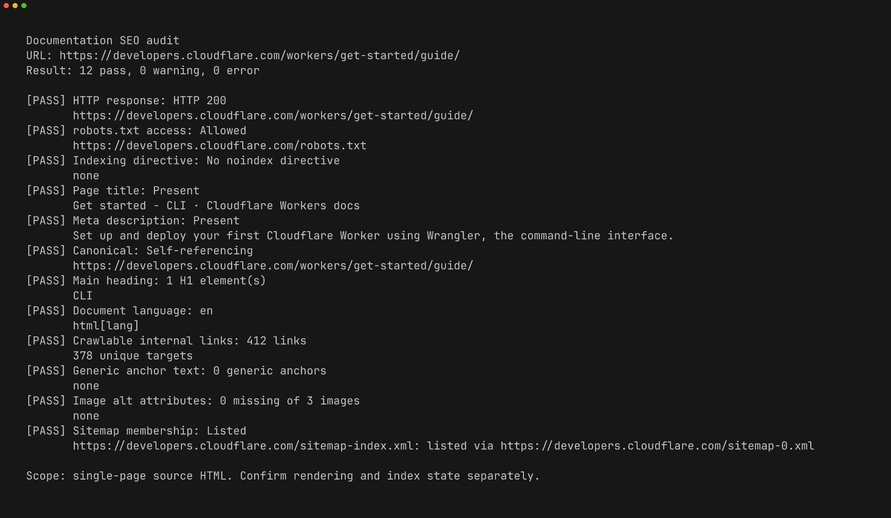

Every developer has used View Source to find out what a page is really made of. View Source shows the HTML exactly as the server sent it, and it's the first thing I'd open in an SEO audit.

A crawler starts from that same HTML, and the page a browser renders after running JavaScript can hide what the HTML is missing.

SEO for documentation is the work of making sure a docs page can be found, read and chosen by a search engine for the task it documents. I treat it as a chain: one page owns each task, a crawler can reach it through a plain link, the source HTML holds the content, and every signal names one URL.

The order matters more than any single check. A page with a perfect title does nothing for you while a duplicate outranks it or its canonical points somewhere else, so this checklist for [technical documentation](/articles/technical-documentation/) runs in dependency order and stops at the first blocking failure.

I built a small audit script for the source-level checks and reran it this week against Cloudflare's Workers CLI guide. The output is further down, along with what the script can't see.

## What does SEO for documentation need to check?

SEO for documentation needs to check seven areas, and a failure in one area blocks the areas listed after it:

| Area | Question | Blocking evidence |
|---|---|---|
| Search intent | Does this page own one developer task? | Another page already answers the same query better |
| Discovery | Can a crawler reach the URL through links? | No crawlable internal link from an indexable page |
| Crawling | Can the server return the page and its required resources? | Blocked URL, redirect loop, repeated `5xx`, inaccessible HTML |
| Indexing | Is the page eligible for search? | `noindex`, soft 404, duplicate without a clear canonical |
| Canonicalization | Do all URL signals identify the same page? | Canonical, sitemap, redirect, and internal links disagree |
| Page quality | Can the reader identify and complete the task? | Generic title, stale version, missing prerequisites, broken example |
| Measurement | Can the team see what happened after release? | No baseline, change annotation, or page owner |

## How do you audit a documentation page for SEO?

Work through these eight checks in order, and fix the first blocking failure before moving to the next one. I've put search intent first because it's the check that can make all the others pointless.

### Step 1. Search intent and page ownership

Start with page ownership, because a developer's search nearly always names a task, an error or a version. The page that owns the query should name that task and show what success looks like.

| Search | Page that should own it | Successful outcome |
|---|---|---|
| `cloudflare workers deploy` | Deployment guide | A Worker reaches a live URL |
| `stripe 401 invalid api key` | Authentication troubleshooting page | The request succeeds after the cause is fixed |
| `kubectl logs flags` | Command reference | The reader chooses and runs the correct flag |
| `oauth refresh token expiry` | Concept plus implementation guide | The application renews access safely |
| `migrate sdk v2 to v3` | Versioned migration guide | The application runs on the supported version |

If two pages complete the same task, compare the documentation, marketing site, support center, changelog, and older versions before writing anything new. A single page should become the canonical owner, with useful material from the weaker page moved into it before the duplicate is redirected or demoted.

The [documentation organization guide](/articles/documentation-structure/) covers that consolidation work in detail.

### Step 2. Internal links and XML sitemaps

Google's [SEO Starter Guide](https://developers.google.com/search/docs/fundamentals/seo-starter-guide) identifies links as a primary way crawlers discover pages. Trace every important documentation URL back to a relevant hub, guide, or sibling page instead of treating its XML sitemap entry as the entire discovery strategy.

The internal route has to make sense for a person too. A useful link carries the reader toward a prerequisite, a deeper explanation, or the next task rather than existing only because an audit wanted another inbound link.

#### Crawlable internal links

Google's [crawlable-link guidance](https://developers.google.com/search/docs/crawling-indexing/links-crawlable) recommends an `<a>` element with an `href` that resolves to a web address. Look for that ordinary HTML before trusting a navigation path, since JavaScript click handlers and empty anchors are less dependable for crawling and keyboard navigation.

```html
<a href="/docs/webhooks/verify-signatures/">
  Verify webhook signatures
</a>
```

The anchor should still identify the destination when someone reads it without the surrounding sentence. “Verify webhook signatures” carries the task on its own, while “Read more” asks both the reader and the crawler to infer it.

#### XML sitemap checks

Treat the sitemap as a record of the URLs the site actually wants search engines to consider. Google's [sitemap guidance](https://developers.google.com/search/docs/crawling-indexing/sitemaps/build-sitemap) recommends fully qualified canonical URLs, which makes the following signals straightforward to compare:

- The sitemap returns `200` and valid XML.
- Every URL uses the preferred host and protocol.
- Redirects, `404` pages, parameter variants, and noncanonical duplicates are absent.
- `<lastmod>` changes only after a meaningful page update.
- The sitemap is declared in `robots.txt` or submitted through Search Console.

Google ignores `<priority>` and `<changefreq>`, so those fields do not need release time.

An [llms.txt file](/articles/llms-txt/) is a separate, optional index for AI tools, and Google Search doesn't read it, so it doesn't replace the sitemap.

### Step 3. Crawling, rendering, and indexing

A browser can make a broken page look healthy once JavaScript has run. So I read the server's response before I look at the layout, because it shows whether the content and the canonical tag exist without a renderer's help.

#### HTTP response and rendered HTML

Start with the final URL and headers:

```bash
curl --silent --show-error --location \
  --dump-header headers.txt \
  --output page.html \
  https://docs.example.com/api/authentication/
```

The response reveals the status code, content type, redirect chain, `X-Robots-Tag`, and cache behavior before presentation enters the picture. The response also exposes branded error pages that return `200` and risk being treated as soft 404s.

Open the page in a clean browser context and compare the rendered result with the source. The stage is complete when the task content, title, headings, navigation, code, links, and canonical appear without a logged-in state or extra interaction.

Google's [JavaScript SEO guidance](https://developers.google.com/search/docs/crawling-indexing/javascript/javascript-seo-basics) explains how rendering affects indexing. Search Console URL Inspection shows Google's indexed view and live-test result.

#### `robots.txt` and `noindex`

`robots.txt` controls crawling, while a page-level or header-level `noindex` controls indexing. The distinction matters because Google still has to crawl a page before it can see the indexing directive.

Resolve duplicates through redirects or canonical signals rather than hiding them in `robots.txt`. A `noindex` directive fits pages that should remain accessible but should not appear in search.

### Step 4. Canonical URLs and documentation versions

Redirects and `rel="canonical"` are strong canonicalization signals. Sitemap inclusion is weaker, so compare the signals together because disagreement usually reveals that templates, navigation, and deployment rules are describing different preferred URLs.

Include:

- Final response URL
- Source `rel="canonical"`
- XML sitemap URL
- Internal-link destinations
- `hreflang` URLs when present
- Structured-data URL
- Open Graph URL

The preferred page needs an absolute self-referencing canonical, with every supporting signal pointing to it. Google's [canonicalization guidance](https://developers.google.com/search/docs/crawling-indexing/consolidate-duplicate-urls) also recommends linking internally to that preferred URL.

```html
<link
  rel="canonical"
  href="https://docs.example.com/api/authentication/"
>
```

Versioned documentation is where policy becomes more important than a universal rule. Choose among three patterns based on whether the old instructions can still produce a valid result:

- **Current version only:** Redirect retired task pages when the old instructions are no longer useful.
- **Multiple supported versions:** Give each version a distinct URL, visible label, navigation path, and self-canonical.
- **Historical versions:** Keep them accessible, then decide whether they should remain indexable based on support and search demand.

If the instructions materially differ, keep the older page distinct rather than canonicalizing it to the current version. The pages are not interchangeable when following the wrong one can break an integration, and the URL policy should preserve that distinction.

### Step 5. Page titles, headings, and task content

Labels such as “Overview,” “Configuration,” and “Usage” lose meaning when they leave their section. A useful label should still identify the task in a search result, browser tab, documentation tree, or copied URL.

The [Google title-link guidance](https://developers.google.com/search/docs/appearance/title-link) recommends a distinct, concise, accurate `<title>`. Google may also use the H1, prominent text, `og:title`, and anchor text when generating a result title.

Strong task pages repeat the same task across the URL, title, H1, description, and opening without repeating the same sentence:

```text
URL:         /docs/webhooks/verify-signatures/
<title>:     Verify webhook signatures | Orbit Docs
H1:          Verify webhook signatures
Description: Validate Orbit webhook signatures and reject replayed requests.
Opening:     Use the signing secret and timestamp header to verify each payload.
```

Reading the headings without the sidebar shows whether the procedure still makes sense. “Create an API key” and “Recover from an expired key” survive that test, while “Setup” and “Errors” depend on navigation context that search visitors may never see.

The task is complete only when the page carries a reader through the required access and versions, a working command or request, expected output, recognizable failure symptoms, recovery, and cleanup. The [technical tutorial guide](/articles/writing-technical-tutorials/) shows how to test that path from a clean environment.

Return version-sensitive pages to the review queue when an SDK release, renamed field, changed permission, UI move, deprecation, support pattern, or ranking loss makes the instructions suspect. The updated date should change when the page itself changes meaningfully, not merely because the review took place.

### Step 6. Performance, mobile, and structured data

Documentation sites reuse a small number of templates across many URLs, which makes template choice part of the evidence. Sample a task guide, API reference, search-results page, and versioned page because a fast homepage says little about how those heavier layouts behave.

#### Core Web Vitals

Field data shows whether visitors experienced a problem, while lab tests reproduce it on the affected template. Documentation regressions often come from client-side search, syntax highlighting, large navigation trees, embedded consoles, chat widgets, and layout shifts when code or fonts load.

A Core Web Vitals number becomes useful when it's recorded next to the element or script that caused it, such as a Largest Contentful Paint of 4 seconds traced to the syntax-highlighting script. Largest Contentful Paint, Interaction to Next Paint, and Cumulative Layout Shift should each lead to a specific template change and another test of the same page, not another generic score on a release checklist.

#### Mobile documentation pages

Test a narrow viewport and browser zoom because code, tables, and navigation often fail there before the prose does. The page passes when code blocks and tables scroll inside their container, while drawers, copy controls, search, feedback, and chat overlays leave the task visible.

The same pass follows a few heading anchors and looks at long endpoint names near sticky navigation. These details matter even when a developer first finds the page on desktop, because the template and indexing signals still serve every device.

#### HTTPS and structured data

A clean documentation path loads the canonical page and its required resources over HTTPS without mixed content. Route HTTP and alternate-host requests to the preferred URL before those variants spread through internal links or the sitemap.

Structured data should follow the visible page rather than inventing a richer result. When `Article` or `TechArticle` and `BreadcrumbList` fit, compare the URL, headline, dates, author, and breadcrumb path with the canonical page before validating the markup.

### Step 7. Run the documentation SEO audit script

I wrote a small Python auditor for this page, using only the standard library. The auditor fetches one URL and runs twelve source-level checks on the page, from the HTTP response and `robots.txt` through the canonical tag to sitemap membership.

The [documentation SEO audit script](/static/tools/docs-seo-audit.py) runs as a standalone file:

```bash
python3 docs-seo-audit.py \
  https://developers.cloudflare.com/workers/get-started/guide/ \
  --json cloudflare-docs-audit.json
```

The command makes read-only requests and returns a human-readable report plus a JSON receipt.

#### Cloudflare Workers audit result

I reran it against Cloudflare's Workers CLI getting-started guide on November 18, 2026, and it printed this:

```text
Documentation SEO audit
URL: https://developers.cloudflare.com/workers/get-started/guide/
Result: 12 pass, 0 warning, 0 error

[PASS] HTTP response: HTTP 200
       https://developers.cloudflare.com/workers/get-started/guide/
[PASS] robots.txt access: Allowed
       https://developers.cloudflare.com/robots.txt
[PASS] Indexing directive: No noindex directive
       none
[PASS] Page title: Present
       Get started - CLI · Cloudflare Workers docs
[PASS] Meta description: Present
       Set up and deploy your first Cloudflare Worker using Wrangler, the command-line interface.
[PASS] Canonical: Self-referencing
       https://developers.cloudflare.com/workers/get-started/guide/
[PASS] Main heading: 1 H1 element(s)
       CLI
[PASS] Document language: en
       html[lang]
[PASS] Crawlable internal links: 453 links
       417 unique targets
[PASS] Generic anchor text: 0 generic anchors
       none
[PASS] Image alt attributes: 0 missing of 3 images
       none
[PASS] Sitemap membership: Listed
       https://developers.cloudflare.com/sitemap-index.xml: listed via https://developers.cloudflare.com/sitemap-0.xml

Scope: single-page source HTML. Confirm rendering and index state separately.
```

The November result of 12 passes matches the August run shown in the screenshot below.



*The receipt records the URL and evidence for each source-HTML check.*

The rendered page also exposes its place in the wider documentation system through the global directory, Workers sidebar, breadcrumbs, page title, outline, prerequisites, and first task.


*The page keeps the current task visible inside the wider product documentation.*

#### Audit script limitations

The script inspects one page's source HTML. The script does not crawl the entire site, execute JavaScript, test Core Web Vitals, confirm Google's selected canonical, or prove that the page deserves to rank.

I'd use the script as the first gate, because it turns the obvious source-level failures into a receipt you can keep. The wider audit still needs a rendered-browser review, Search Console's URL Inspection and a person trying to complete the task.

### Step 8. Measure documentation search performance

A baseline gives the team a point of comparison before a title, canonical, internal-link path, template, or version policy changes. Save the page and query data with the release date, then compare equivalent windows after search engines have had time to recrawl the page.

Clicks, impressions, CTR, average position, index state, and the URL selected for the query each describe a different part of the result. The process has worked when the team can explain what moved, test the likely cause against the page and competing results, and choose the next change without guessing.

## A technical SEO checklist for documentation sites

Here's the same audit as a list you can run during a release review.

### Search intent

- [ ] The page names one reader, task, and successful outcome.
- [ ] Site search and web search show no stronger page for the same intent.
- [ ] Marketing, support, reference, tutorial, and version pages have distinct jobs.
- [ ] One canonical page owns the task.

### Discovery and crawling

- [ ] At least one relevant indexable page links to the URL.
- [ ] Links use `<a href>` and resolve without a click handler.
- [ ] The canonical URL appears in the XML sitemap.
- [ ] The final response returns the correct status and HTML content type.
- [ ] `robots.txt` allows required crawling.
- [ ] Initial and rendered HTML contain the task content, links, and canonical.
- [ ] Error pages return honest status codes instead of soft `200` responses.

### Indexing and canonicalization

- [ ] No accidental page-level or header-level `noindex` exists.
- [ ] The preferred page has an absolute self-referencing canonical.
- [ ] Redirects, internal links, sitemap entries, and structured data use the same URL.
- [ ] Parameters, print views, and trailing-slash variants are handled deliberately.
- [ ] Language and version pages have a documented indexing policy.
- [ ] Search Console confirms the intended canonical after processing.

### Page quality

- [ ] URL, `<title>`, H1, description, and opening name the same task.
- [ ] The title is unique, concise, current, and free of boilerplate stuffing.
- [ ] Headings expose the procedure when read without the sidebar.
- [ ] Prerequisites and supported versions appear before dependent steps.
- [ ] Commands and examples run in the promised environment.
- [ ] Expected output, failure symptoms, recovery, and cleanup are present.
- [ ] Images have contextual alt text and useful captions.
- [ ] Code, tables, navigation, and overlays work at narrow widths and browser zoom.

### Performance and structured data

- [ ] Field and lab performance checks cover representative documentation templates.
- [ ] Client-side search, syntax highlighting, consoles, fonts, and widgets do not block the task.
- [ ] Code blocks and tables do not create page-level horizontal overflow.
- [ ] Every canonical page and required resource loads over HTTPS without mixed content.
- [ ] `Article` or `TechArticle` and `BreadcrumbList` fields match visible content and the canonical URL.

### Measurement

- [ ] Page-query performance and index state are saved before and after changes.
- [ ] Publish and update dates are annotated beside the measurement window.
- [ ] Growth and decline are recorded separately from proposed causes.
- [ ] The page has an owner and product-triggered update conditions.
- [ ] Review dates match the site's crawl rate and query volume.

## Where should you start?

Start with one path that affects product use, such as setup or authentication. I'd finish and measure that one path before widening the audit, because a fixed path teaches you which of your templates cause the failures.

## FAQ

**Is SEO different for documentation sites?**

The rules are the same and the failures are different. Docs sites tend to break on duplicate versions, JavaScript-rendered content and pages that share one generic title like "Overview".

**Does Google use the priority field in a sitemap?**

No. Google's sitemap guidance says it ignores `<priority>` and `<changefreq>`, and uses `<lastmod>` when the value is consistently accurate.

**Should old documentation versions be indexed?**

Only when their instructions still work for someone. A supported version gets its own URL and a self-canonical, and a retired one is better redirected.

**Can `robots.txt` remove a page from Google?**

No. A `robots.txt` rule stops crawling, and a blocked page can still appear in results, so removal needs a `noindex` that the crawler is allowed to see.

**Does llms.txt help with Google rankings?**

No. Google Search doesn't read it, so it sits beside the sitemap as an optional index for AI tools.
