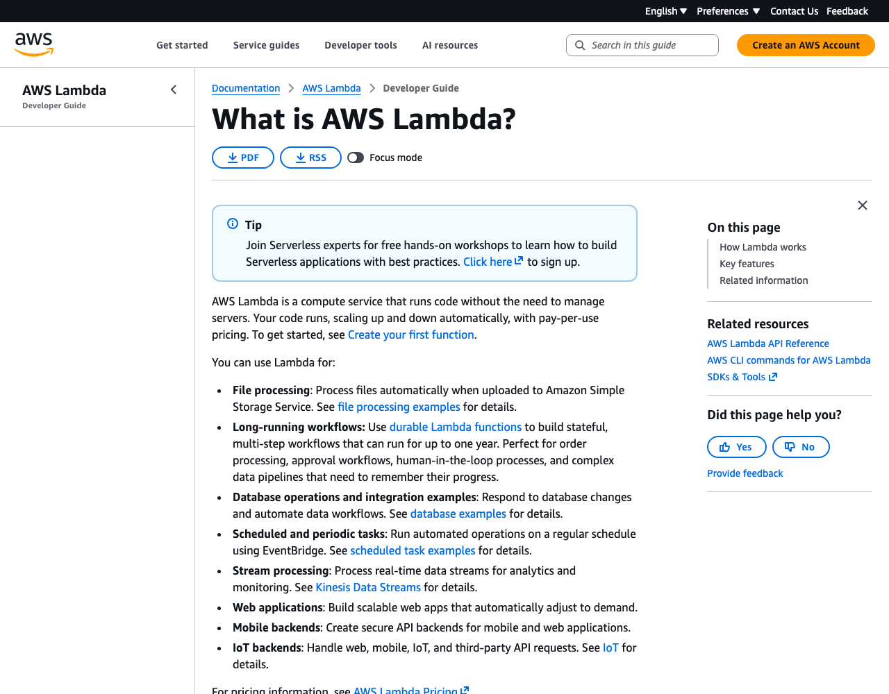

Melvin Conway wrote in 1967 that organizations produce designs which are "copies of the communication structures of these organizations", and programmers have called that [Conway's law](https://en.wikipedia.org/wiki/Conway%27s_law) since. A docs sidebar with one section per engineering team is Conway's law applied to documentation.

A documentation structure works when it follows the reader through setup and use, then through failure and change. I call each of those paths a route, and I'd organize [technical documentation](/articles/technical-documentation/) around routes and keep team ownership out of the menu.

My test for any navigation label is that it narrows the reader's next decision. A label that only shows which team owns the pages, say "Platform Services", belongs in repository metadata such as a CODEOWNERS file.

## What should you do before you redraw the navigation?

Inventory the pages before you debate labels. For each page, record what it helps a reader do, what evidence shows it's still true, and what should happen to its URL.

A new tree drawn without that inventory keeps the pages people argue for and breaks inbound links nobody looked up.

### Record what each page is for

Use fields that separate where a page lives from what it does. The URLs and page names in this example are invented:

| Field | Example |
| --- | --- |
| Current URL | `/developers/api-auth/` |
| Page title | API authentication |
| Reader task | Send an authenticated API request |
| Audience | Application developer |
| Page job | How-to guide |
| Product area | Platform API |
| Lifecycle stage | Setup |
| Evidence | Current schema and inbound links |
| Overlap | `/getting-started/api-key/` |
| Proposed action | Consolidate and redirect |

A "keep" decision needs a reason other than someone liking the page. A "delete" decision needs a look at the page's traffic and inbound links first.

Search the repository for duplicate wording and for links to the page. The patterns and directories below are an illustration, so replace them with your repository's terms and paths:

```bash
rg -n -i 'api authentication|create.*api key|authorization: bearer' content/
rg -n '/developers/api-auth/' content/ templates/ static/
```

If two pages answer the same task, flag the collision before you move either URL. If two pages share a subject but one teaches a procedure while the other lists exact fields, keep both and say on each page where the other takes over.

### Why isn't a list of URLs and titles enough?

A spreadsheet of URLs and titles makes a current reference page and an abandoned launch announcement look the same. Add a column for the source that proves the page is true, say the current API schema, then a column for the canonical decision and a column for the migration action.

Decide whether a page's answer is still true before you move the page.

## How do you organize documentation around what readers do?

Organize it by the state the reader is in when they arrive. A reader is evaluating the product, setting it up, building on it, running it in production, recovering from a failure or upgrading.

Those states outlast department names, which change when the company reorganizes.

Write down representative tasks before you name any section:

- Decide whether the product supports a required use case.
- Create credentials and send a first request.
- Add a capability to an existing integration.
- Diagnose a failed request.
- Prepare a production deployment.
- Upgrade without breaking supported behavior.

Give setup, routine use, failure and change each a visible destination in the navigation. A site with a polished quickstart and nothing after it but a search box has covered setup and left out use, failure and change.

### When should an audience get its own section?

Give an audience its own section when its permissions, terms or actions differ from another audience's. An administrator and an application developer may both need authentication docs, and that alone doesn't justify an Administrators section.

Test the split by writing one sentence per audience that says where they start. The roles and the API-key task below are invented:

```text
Administrator: I need to define which roles may create API keys.
Developer: I have an approved role and need to send an authenticated request.
```

Those two sentences lead to different actions, so the split is justified. If both led to the same task, the second section would exist only because the product has a second role.

Vendors can also use one word for different things with no role involved, as they do with [the word harness in agent docs](/articles/what-agent-harness-means/).

### Where do tutorials, how-to guides, reference and explanation go?

The [Diataxis framework](https://diataxis.fr/start-here/) names four kinds of documentation, each answering a different reader need: tutorials, how-to guides, reference and explanation. I wouldn't turn those four kinds into the four top-level sections of a site.

Put the explanation of a deployment choice beside the deployment procedure when the reader needs it to pick an option. Keep the API reference as its own section, because developers open it directly to look up a field.

If a reader has to leave "Deploy" for a general "Concepts" section to understand a choice the Deploy page just asked them to make, move that explanation next to the procedure.

## What job does each navigation layer do?

A docs page has a global bar, a sidebar and a page outline, and each answers a different question. The global bar picks a kind of content, the sidebar shows where the page sits in one product area, and the page outline lists the sections of the current page.

A link that repeats the layer above it without narrowing the choice can go.

### The global bar picks a kind of content

Top-level labels should still be true after the next release. Labels such as API reference and Release notes keep their meaning while the features under them change.

A feature name that could disappear in the next release is too narrow for the global bar.

### The sidebar shows the route through one product area

The sidebar should answer what belongs to this product area and what comes next. A sequence such as Start, Build, Operate, Troubleshoot and Upgrade does that.

The [AWS Lambda developer guide](https://docs.aws.amazon.com/lambda/latest/dg/welcome.html) shows the layers side by side: an AWS-wide header, the Lambda guide's own tree, breadcrumbs and an outline of the current page. I'm citing the page for how it separates those jobs, and its labels fit Lambda and wouldn't transfer to another product.

<div class="visual-wrapper">
  <div class="visual-title">Navigation layers in the AWS Lambda documentation</div>
  <div class="visual-container">
    
  </div>
</div>
<p class="visual-caption">The header chooses a destination. The sidebar locates the page inside Lambda, and the page outline exposes only the current document.</p>

Remove a sidebar link when it opens the whole product library, or when it repeats a global destination without narrowing the reader's choice.

### The page outline lists the current page

An on-page table of contents helps someone scan a long page, and it can't fix a page that covers five unrelated tasks. If the outline of one page reads like a small site map, split the page.

[W3C's page-structure tutorial](https://www.w3.org/WAI/tutorials/page-structure/) covers headings, page regions and labels for those regions. Use one descriptive H1 and keep the heading levels in order.

## What should a documentation landing page do?

A landing page should tell the reader what the section helps them do, where a new reader starts, and which branch fits a returning reader. A grid of twelve cards with the same weight leaves that whole choice to the reader.

### State the condition for each branch

A short decision table states the conditions. The API docs sections below are invented:

| Reader state | Start here | Proof of fit |
| --- | --- | --- |
| Evaluating the API | API overview | Supported use cases and limits are visible |
| Sending a first request | Quickstart | A test response is the finish line |
| Adding one capability | How-to guides | The reader already has a working integration |
| Looking up a field | API reference | Exact types and constraints are present |
| Recovering from failure | Troubleshooting | Symptoms lead to diagnostics and recovery |

If the cards differ only by topic name, rewrite each one around where the reader starts and where they end up.

### Write link text that works alone

"Get started with the JavaScript SDK" still makes sense when read outside its paragraph, and "Learn more" doesn't. Read each link's text with the surrounding prose covered, and rewrite any link whose destination you can't guess.

If the first screen offers four starting points with the same weight, name the reader each one serves and merge any two that serve the same reader.

## How do you stop two pages from answering the same question?

Pick one canonical page for each answer before you move any URL. A page can be linked from several routes and still live at one address.

Copying the same instructions into each section gives a search engine [two pages competing for one query](/articles/docs-seo/), and the copy nobody remembers to update goes stale.

GitLab's [documentation folder guidance](https://docs.gitlab.com/development/documentation/site_architecture/folder_structure/) gives each top-level folder a stated boundary: `doc/install/` holds "Instructions for installing GitLab" and `doc/update/` holds "Instructions for updating GitLab". The folder names are GitLab's own, and the part I'd copy is that every path says what belongs in it.

### Split a shared subject by job

An authentication guide and an authentication reference share a subject without doing the same job. The split below is an example:

| Page | Owns | Does not own |
| --- | --- | --- |
| Authentication guide | Create, store, use, rotate, and recover a key | Complete field and error schema |
| Authentication reference | Schemes, header format, scopes, status codes, and errors | The end-to-end setup path |

If both pages carry the same setup procedure with different update dates, pick one page to own the procedure and have the other link to it.

### When should a URL change?

Change a URL only when it misstates the product or the canonical content has moved. A navigation label can be reworded without touching the path.

When a path has to move, record where it goes and why. The paths below are invented:

| Old URL | New URL | Reason | Action |
| --- | --- | --- | --- |
| `/developers/api-auth/` | `/docs/guides/authentication/` | Procedure consolidated | Permanent redirect |
| `/getting-started/api-key/` | `/docs/start/create-api-key/` | Duplicate setup path | Permanent redirect |
| `/resources/errors/` | `/docs/api-reference/errors/` | Reference moved | Permanent redirect |

Don't redirect a removed page to the documentation homepage, because the homepage doesn't answer the question the old page answered. Return a `404` when no equivalent page exists.

## How do you test a documentation structure before migrating?

Test the labels on a spreadsheet, a plain-text tree or a clickable prototype before any page moves. A new documentation platform isn't needed to find out that a label like "Resources" tells a reader nothing.

The test works only if a reviewer can pick a destination and explain the pick with no help from whoever designed the tree.

### Give reviewers tasks without naming the section

The errors, versions and requests below are example prompts:

- Your webhook signature check returns `401`. Where do you look?
- You need to confirm whether Node.js 24 is supported.
- You have credentials and want to send a first Python request.
- You are preparing an upgrade from version 2 to version 3.

Ask the reviewer to choose a destination and say why the label fit. When two labels look equally right, rename one of them, and when search is the only way to reach an ordinary task, add that task to the navigation.

### Give each page one parent

Export the proposed URLs and assign each one a single parent. Then check the reverse: each landing page should list its immediate children and say how to choose between them.

The paths below are an example tree:

```text
/docs/start/                         parent: /docs/
/docs/start/create-api-key/          parent: /docs/start/
/docs/guides/authentication/         parent: /docs/guides/
/docs/api-reference/authentication/  parent: /docs/api-reference/
```

Before you migrate content, fix any page with no parent, any page with two parents, and any landing page that doesn't link to its children.

## What does the reorganization look like on one site?

The example below reorganizes the docs for Orbit, an API I invented for this page. Orbit's navigation and pages aren't a client's, and nothing in the example is evidence about a real product.

Say Orbit's navigation reads Getting Started, Guides, Features, Developers, Resources, API, Help and Learn. The same authentication steps appear under Getting Started, Developers and API, while errors and upgrades have no predictable home.

Menus like that follow the org chart, because each section exists for the team that publishes there.

### Draft the routes before the sections

Suppose the inventory turns up five reader routes:

1. Evaluate the API and choose an integration method.
2. Create credentials and send the first request.
3. Build imports and webhooks.
4. Operate the integration through errors, limits, and monitoring.
5. Upgrade API versions and SDKs.

Those routes produce this first tree:

```text
Documentation
|-- Start
|   |-- API overview
|   |-- Create an API key
|   `-- Send your first request
|-- Guides
|   |-- Authentication
|   |-- Imports
|   `-- Webhooks
|-- API reference
|   |-- Authentication
|   |-- Endpoints
|   `-- Errors
|-- SDKs
|   |-- JavaScript
|   `-- Python
|-- Operate
|   |-- Troubleshoot requests
|   `-- Monitor usage
`-- Change
    |-- API versions
    |-- Migration guides
    `-- Release notes
```

"Start" stays small. "Operate" and "Change" give the reader somewhere to go after the first successful response.

### Give authentication one canonical home

The guide owns everything a reader does with a key, from creating it to rotating it. The reference owns the header format, the scopes, the status codes and the error schema.

The two old setup pages answer the same task, so their useful material moves into **Create an API key** and both old URLs redirect there. On a real site I'd check traffic and inbound links before moving either URL.

### Test one landing page before migrating the tree

Build the Start page with working prototype links and give reviewers this prompt:

> You have an account but no credentials. Find the shortest supported route to a successful test API response.

If reviewers open the API reference before **Create an API key**, change the label or its position. If they finish setup and can't tell whether the request worked, add a visible success check to the task page.

A reviewer who takes the wrong route has found a problem with the label, so the label is what changes.

### Check the routes again after launch

Each observation below suggests a defect without proving one, so each row ends in a next check:

| Observation | Possible defect | Next check |
| --- | --- | --- |
| Search repeats a visible navigation label | Label may be hidden or misplaced | Run the same findability prompt |
| Old URLs remain common entrances | Redirect or inbound links may be stale | Inspect referrers and redirect hops |
| Readers move between two setup pages | Canonical task may be unclear | Compare the two page jobs |
| Support links bypass landing pages | Landing route may not reach the answer | Ask why the direct link was needed |

A lower bounce rate doesn't show that the structure works. The evidence I'd accept names a decision the reader had to make and the label or page that was changed to help with it.

The [documentation accessibility checklist](/articles/docs-accessibility/) covers the heading and region checks to run before the migration ships.

## Documentation structure checklist

- Inventory each page's job, its evidence, its overlaps and what happens to its URL.
- Build routes through setup, routine use, failure and change.
- Give the global bar, the sidebar and the page outline one job each.
- Test landing-page labels with reviewers before migrating.
- Keep one canonical URL per answer and redirect each old URL straight to its new page.
- After launch, turn each odd observation into a named check.

## FAQ

**What is documentation structure?**

Documentation structure is how a docs site groups and links its pages: the navigation labels, the landing pages, the URL paths and the order a reader meets them in.

**Should documentation follow the Diataxis framework?**

Diataxis is useful for deciding what kind of page you're writing. I wouldn't use its four kinds as the top-level sections, because readers arrive with a task, and an explanation often belongs beside the procedure it supports.

**Do I need a new documentation platform to restructure docs?**

No. A spreadsheet inventory and a plain-text tree are enough to test labels with reviewers, and the platform decision can wait until the tree has passed those tests.

**How many levels of navigation should a docs site have?**

I'd use a global bar, a sidebar for one product area and an outline of the current page. If the sidebar needs another level below that, I'd first check whether one page is covering several tasks.
