On October 26 Cloudflare published [a report](https://blog.cloudflare.com/kv-cache-exposure-remediation/) on a bug in which 155 responses from a model on Workers AI contained text from other customers' requests. The leaked text had been sitting in the KV cache.

The KV cache is the memory where a language model keeps the key and value vectors it has computed for every token so far. It exists so that generating the next token doesn't mean recomputing the whole sequence, and it grows with every token in the context.

Cloudflare calls what happened a memory-safety bug, and it reads to me like one from an older era. [Heartbleed](https://en.wikipedia.org/wiki/Heartbleed), disclosed in April 2014, was a server reading past the data it should have and handing back whatever was there, and this was a model attending over cache pages nobody had cleared.

So the KV cache is worth understanding as memory, with a size and a lifetime and an owner. That's how I've written this page, which sits with the other serving topics under [AI engineering](/articles/ai-engineering/).

## What is the KV cache?

The KV cache is a per-sequence store of the keys and values that each attention layer computed for earlier tokens. When the model generates token 1,001, it computes keys and values for that one token and reads the other 1,000 from the cache.

The cost is memory that grows as the conversation does. The [H2O paper](https://arxiv.org/abs/2306.14048) describes the cache as state held in GPU memory besides the model's weights, "scaling linearly with the sequence length and batch size".

That linear growth is the reason a [context window](/articles/llm-context-windows/) has a hardware price as well as a token price.

## How big is the KV cache?

It's two vectors per token for every KV head in every layer, so you can work it out from a model's config file. The script below does it for [Qwen2.5-7B-Instruct](https://huggingface.co/Qwen/Qwen2.5-7B-Instruct/blob/main/config.json), using the numbers in its published config:

```python
"""Size the KV cache of a model from its config. Numbers are for Qwen2.5-7B-Instruct."""
config = {"num_hidden_layers": 28, "num_attention_heads": 28, "num_key_value_heads": 4, "hidden_size": 3584}
BYTES_PER_VALUE = 2          # bfloat16, the dtype in the same config
head_dim = config["hidden_size"] // config["num_attention_heads"]


def kv_bytes(tokens, kv_heads):
    # one key vector and one value vector per token, per KV head, per layer
    return 2 * config["num_hidden_layers"] * kv_heads * head_dim * BYTES_PER_VALUE * tokens


per_token = kv_bytes(1, config["num_key_value_heads"])
print(f"head dimension: {head_dim}")
print(f"KV cache per token: {per_token:,} bytes")
for tokens in (4_096, 32_768, 131_072):
    grouped = kv_bytes(tokens, config["num_key_value_heads"]) / 2**30
    ungrouped = kv_bytes(tokens, config["num_attention_heads"]) / 2**30
    print(f"{tokens:>7,} tokens: {grouped:5.2f} GiB per sequence ({ungrouped:5.2f} GiB if every head kept its own keys and values)")
```

Running `python kv_size.py` printed:

```text
head dimension: 128
KV cache per token: 57,344 bytes
  4,096 tokens:  0.22 GiB per sequence ( 1.53 GiB if every head kept its own keys and values)
 32,768 tokens:  1.75 GiB per sequence (12.25 GiB if every head kept its own keys and values)
131,072 tokens:  7.00 GiB per sequence (49.00 GiB if every head kept its own keys and values)
```

A full 131,072-token context costs 7 GiB of cache for one sequence, on top of the weights. Serve eight such conversations at once and the cache needs 56 GiB.

The figure in brackets is what the same model would need if each of its 28 attention heads stored its own keys and values. The config sets `num_key_value_heads` to 4, so groups of heads share them and the cache is a seventh of that size.

The script counts the cache tensors and nothing else. A serving engine adds its own overhead, so I'd treat the result as a floor.

## What happens when the KV cache fills up?

Something has to go, and the research on [KV cache eviction](/glossary/kv-cache-eviction/) is about which tokens to drop. The policies differ in what they protect:

<figure class="np-figure">
  <a class="np-figure-zoom" href="/static/images/diagrams/kv-cache-eviction/eviction-policies.svg"><picture><source media="(max-width: 712px)" srcset="/static/images/diagrams/kv-cache-eviction/eviction-policies.narrow.svg" width="288" height="1000"></picture></a>
  <figcaption>StreamingLLM keeps the first tokens and the recent ones and forgets the middle. H2O keeps the tokens with the highest attention scores.</figcaption>
</figure>

Dropping the oldest tokens is the obvious policy, and the [StreamingLLM paper](https://arxiv.org/abs/2309.17453) shows it fails once the text is longer than the cache. Its authors traced the failure to the first few tokens, which collect strong attention "even if they are not semantically important", and they named those tokens attention sinks.

Keep the sinks and the recent tokens, and the model stays stable. The paper reports stable language modeling at up to 4 million tokens that way, and what it gives up is everything in the middle.

H2O keeps tokens by how much attention they've drawn. It rests on the observation that a small share of tokens accounts for the bulk of the attention score, and its eviction policy retains a balance of those heavy hitters and recent tokens.

[SnapKV](https://arxiv.org/abs/2404.14469) decides once, before generation starts. It looks at what the end of the prompt attends to and keeps those positions, and its authors report an 8.2x gain in memory efficiency on 16K-token inputs with comparable accuracy on 16 long-sequence datasets.

<figure class="np-figure">
  <a class="np-figure-zoom" href="/static/images/diagrams/kv-cache-eviction/attention-map.svg"><picture><source media="(max-width: 712px)" srcset="/static/images/diagrams/kv-cache-eviction/attention-map.narrow.svg" width="288" height="424"></picture></a>
  <figcaption>An illustration of the pattern, not observed attention data. Drop a heavy hitter and generation can destabilize.</figcaption>
</figure>

I'd read all of these numbers as each paper's own, on its own models and tasks. An evicted token is gone for the rest of the generation, so the test that matters is whether your task needed it.

## Do serving engines evict tokens for you?

Not in the sense these papers mean, as far as the docs I checked go. What vLLM documents is reuse: its [automatic prefix caching](https://docs.vllm.ai/en/latest/features/automatic_prefix_caching/) lets a new request skip computing a prefix it shares with an earlier one by reusing that prefix's KV cache.

That's the same cache working in your favour. A long system prompt is computed once and its keys and values serve every request that starts with it, which is how prefix caching shortens [time to first token](/articles/time-to-first-token/).

So the decisions you'll make in practice are about size and sharing. How many tokens the pool holds, and which requests may read which pages, are settings on the page about [LLM inference optimization](/articles/llm-inference-optimization/) too.

## Why is the KV cache a security boundary?

Because it holds other people's prompts in a form the model can read. Cloudflare's incident is the clearest account of that I've seen, and it started with a size mismatch.

The model was deployed with a 1,048,576-token context window, and the cache pool on the prefill GPUs had room for 681,280 tokens. A longer prompt was rejected internally, and a bug in the inference engine, SGLang, let generation go ahead anyway over pages that still held earlier requests.

Cloudflare's own summary is the line I'd keep: "This bug belongs to a class of KV cache memory-safety bugs". The fixes read like memory-safety fixes too, with the pool made larger than the context and the rejection path made to return an error.

The lesson I take is about sizing. If the context window you advertise is larger than the cache you provisioned, the difference is a code path, and it'll run someday.

## FAQ

**What does KV stand for in KV cache?**

Key and value. They're the two vectors each attention layer computes per token, and later tokens read them instead of recomputing them.

**Is the KV cache the same as prompt caching?**

Prompt caching is built on it. A provider that caches a prompt prefix is keeping that prefix's keys and values so the next request can reuse them.

**Does the KV cache grow with batch size?**

Yes. Each sequence in a batch has its own cache, so memory grows with both the length of each sequence and the number of them.

**What is an attention sink?**

It's one of the first few tokens of a sequence, which attract strong attention whatever they say. StreamingLLM found that keeping them is what stops a sliding window from failing.

**Can evicting tokens from the KV cache change the answer?**

Yes. An evicted token can't be attended to again, so anything the answer needed from it is lost.
