Semantic caching stores the answer an LLM gave to a question and returns it again when a new question means the same thing. It decides "the same thing" by comparing embeddings, so two questions can match without sharing a word.

An HTTP cache has a simpler job. [RFC 9111](https://www.rfc-editor.org/rfc/rfc9111.html) builds the cache key from the request method and the target URI, and notes that many caches in common use key on the URI alone.

Questions typed by people have no URI. The same request arrives in a hundred phrasings, so a cache in front of a [RAG pipeline](/articles/rag/) has to judge closeness, and that judgment is where it goes right or wrong.

<figure class="np-figure">
  <a class="np-figure-zoom" href="/static/images/diagrams/semantic-caching/semantic-cache.svg"><picture><source media="(max-width: 712px)" srcset="/static/images/diagrams/semantic-caching/semantic-cache.narrow.svg" width="288" height="664"></picture></a>
  <figcaption>A hit returns the stored answer and skips retrieval and generation. A miss runs the pipeline and stores the result for next time.</figcaption>
</figure>

## What is semantic caching?

It's a lookup that runs before retrieval and generation, keyed on meaning. The [glossary entry](/glossary/semantic-caching/) has the short definition, and the mechanism has four steps.

1. Embed the incoming question with an embedding model.
2. Search the stored questions for the nearest one.
3. Compare the similarity score with a threshold.
4. On a hit, return the stored answer, and on a miss, run the full pipeline and store the result.

So a hit costs one embedding and one vector search. Everything after that in the pipeline is skipped.

## How much can a semantic cache save?

It depends on how much your traffic repeats, and the published figures come from favourable traffic. A paper from November 2024, [GPT Semantic Cache](https://arxiv.org/abs/2411.05276) by Sajal Regmi and Chetan Phakami Pun, reports that its cache "reduces API calls by up to 68.8% across various query categories".

The same abstract reports that over 97% of its hits were correct ones. Those are the authors' numbers on the query categories they chose, and I'd treat them as a ceiling for support-style questions.

A conversation where every message depends on the last one repeats far less. So measure the repeat rate in your own logs before you build anything.

## How do you choose a similarity threshold?

Start high and lower it while you watch for wrong hits. Redis's [guide to semantic cache tuning](https://redis.io/blog/10-techniques-for-semantic-cache-optimization/) suggests 0.88 cosine similarity as a starting point for an FAQ cache, then moving down gradually.

The trouble is that one number has to separate two kinds of near neighbour. The script below scores a handful of new questions against a small cache with an open embedding model, at several thresholds.

```python
"""Score new questions against a small cache of answered ones, at three thresholds."""
import numpy as np
from fastembed import TextEmbedding

MODEL = "BAAI/bge-small-en-v1.5"
CACHED = [
    "How do I reset my password?",
    "How do I cancel my subscription?",
    "What is your return policy?",
]
NEW = [
    ("I forgot my password, how can I change it?", "How do I reset my password?"),
    ("Can I send an item back?", "What is your return policy?"),
    ("How do I cancel my last order?", None),
    ("When does my plan renew?", None),
]
THRESHOLDS = [0.80, 0.88, 0.92]

model = TextEmbedding(MODEL)


def embed(texts):
    vectors = np.array(list(model.embed(texts)))
    return vectors / np.linalg.norm(vectors, axis=1, keepdims=True)


cache = embed(CACHED)
print(f"model: {MODEL}")
print(f"{'new question':<44}{'nearest cached question':<34}{'cosine':<8}" + "".join(f"{t:<7}" for t in THRESHOLDS))
for question, right_answer in NEW:
    scores = cache @ embed([question])[0]
    best = int(scores.argmax())
    cells = []
    for t in THRESHOLDS:
        if scores[best] < t:
            cells.append("miss")
        elif CACHED[best] == right_answer:
            cells.append("hit")
        else:
            cells.append("WRONG")
    print(f"{question:<44}{CACHED[best]:<34}{scores[best]:<8.3f}" + "".join(f"{c:<7}" for c in cells))
```

Run on November 17, it printed this.

```text
model: BAAI/bge-small-en-v1.5
new question                                nearest cached question           cosine  0.8    0.88   0.92
I forgot my password, how can I change it?  How do I reset my password?       0.914   hit    hit    miss
Can I send an item back?                    What is your return policy?       0.761   miss   miss   miss
How do I cancel my last order?              How do I cancel my subscription?  0.807   WRONG  miss   miss
When does my plan renew?                    What is your return policy?       0.644   miss   miss   miss
```

Look at the middle two rows. "Can I send an item back?" is a fair paraphrase of the return policy question and scores 0.761, and "How do I cancel my last order?" is a different request from cancelling a subscription and scores 0.807.

So the wrong match outscored a right one. No threshold serves the first without also serving the second, and at 0.80 the cache hands a customer the wrong answer.

A handful of questions and one small model prove nothing about your traffic. But they show why a threshold needs testing against labelled pairs from your own domain, wrong neighbours included.

## What makes a cached answer wrong later?

Anything the answer depended on that has since changed. An exact-match cache drops a key, and a semantic cache has no key to drop, only a region of similar questions.

The usual causes are a changed source document, a changed system prompt and a changed model. The fix I'd reach for first is to store a version with each entry, made of the document version and the prompt version, and to treat a mismatch as a miss.

A time limit on entries covers what versions don't. And changing the embedding model means rebuilding the cache, since scores from one model can't be compared with vectors from another.

## When should you skip semantic caching?

Skip it when two people asking the same words need different answers. "When does my plan renew?" is identical text for every customer, so a cache keyed on meaning alone will serve one customer's date to another.

Skip it for agent steps as well. A prompt that carries tool results and history is close to unique on every turn, so the lookup adds latency and seldom hits.

And skip it for anything live, such as a price or a queue length. A cached answer there is wrong as soon as the number moves.

## Where does a semantic cache sit in a RAG pipeline?

It sits in front of everything. A hit skips the query embedding for retrieval, the search, the reranker and the model call, so it saves more than the model's bill.

That makes it a different kind of work from improving retrieval. [Contextual retrieval](/articles/contextual-retrieval/) and [reranking](/articles/rag-reranking/) make a miss cheaper or better, and the cache decides how often a miss happens.

It's also a different thing from the prompt caching that model providers offer, which discounts a repeated prefix inside a request that still runs. The [token budgets guide](/articles/llm-token-budgets/) works out what that one saves.

## FAQ

**What is semantic caching?**

It's a cache for LLM answers keyed on the meaning of the question. A new question that is similar enough to a stored one gets the stored answer without the model being called.

**What similarity threshold should I start with?**

Redis suggests 0.88 cosine similarity for an FAQ cache. Then test it against pairs of questions from your own domain, including pairs that look alike and need different answers.

**How do I invalidate a semantic cache when the knowledge base changes?**

Store the source document's version with each entry and treat a mismatch as a miss. A time limit on entries catches the changes that versioning doesn't.
