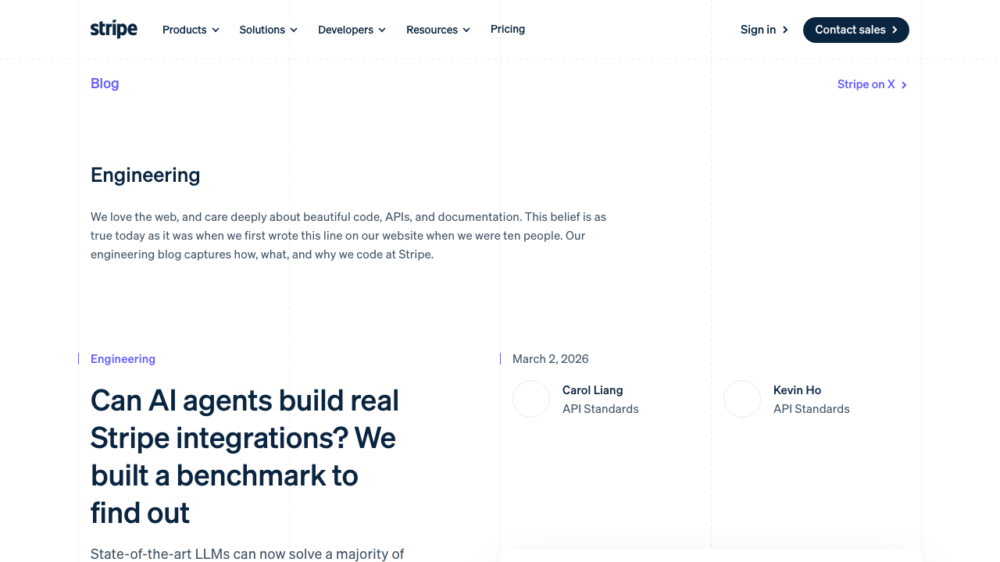

The five newest posts on Stripe's engineering blog are all about agents. Between September 14 and November 2, 2026 it published an internal prototyping agent, a Checkout design for AI agents, a system that orchestrates agents to build payment-method integrations, agent-assisted fraud modelling, and sandboxes an agent can use before anyone has signed up.

That run explains the blog better than the word moat does. Stripe's engineering blog became an advantage because it follows whoever is integrating Stripe at the moment and explains the hard part to them in public, and this autumn that reader is a developer working through a coding agent.

For [developer content](/articles/developer-experience/), this blog is the example I come back to.

## Where the Stripe engineering blog lives and what it publishes

The Stripe engineering blog is at [stripe.dev/blog/topic/engineering](https://stripe.dev/blog/topic/engineering), the engineering section of Stripe's developer blog. The old address, stripe.com/blog/engineering, returned a 301 to it when I checked on 2026-10-29.

Its posts describe how Stripe builds its own systems, not how to call the API. Recent ones cover [a distributed proxy for its data plane](https://stripe.dev/blog/building-a-data-plane-from-scratch-stripes-own-high-performance-distributed-proxy), [auto-remediating a database fleet with graph search and state machines](https://stripe.dev/blog/how-stripe-uses-graph-search-and-state-machines-to-auto-remediate-a-global-database-fleet), [formatting 25 million lines of Ruby overnight](https://stripe.dev/blog/formatting-an-entire-25-million-line-codebase-overnight-the-rubyfmt-story) and [machine learning for Radar fraud detection](https://stripe.dev/blog/scaling-radar-fighting-fraud-with-agent-assisted-machine-learning).

The rest of [stripe.dev/blog](https://stripe.dev/blog) holds integration tutorials on Billing, Connect, sandboxes, Workbench and AWS. Product launches, industry research and company news stay on [stripe.com/blog](https://stripe.com/blog).

The Engineering topic listed 28 posts when I checked on 2026-11-17.

  
Stripe Engineering Blog Landing Page, Before the Move to stripe.dev

  

    
  

## What the Stripe engineering blog is writing about now

The current subject is the agent as a Stripe developer, in every one of the five latest engineering posts.

| Date | Post | What it explains |
| --- | --- | --- |
| 2026-11-02 | [Claimable sandboxes](https://stripe.dev/blog/claimable-sandboxes-frictionless-stripe-accounts-for-agents) | Test accounts an agent can use without registration |
| 2026-10-19 | [Scaling Radar](https://stripe.dev/blog/scaling-radar-fighting-fraud-with-agent-assisted-machine-learning) | Fraud models improved through agent-run experiments |
| 2026-09-30 | [Payment Method Factory](https://stripe.dev/blog/stripes-payment-method-factory-orchestrating-agents-for-repeated-custom-integrations) | Agents producing repeated custom integrations from reusable prompts |
| 2026-09-22 | [Checkout for AI agents](https://stripe.dev/blog/how-stripe-is-designing-checkout-for-ai-agents) | Agent purchases from the browser over WebMCP |
| 2026-09-14 | [Harbor](https://stripe.dev/blog/harbor-stripes-ai-assisted-prototyping-tool) | The internal tool Stripe teams use to prototype with an agent |

The sandbox post, by Mathew Varughese and Cara Mecozzi, opens with the reason the product had to change.

"When it takes 40 minutes to build a payments integration, spending a minute signing up isn't that big of a deal. But when an agent only takes a few minutes to build an integration, suddenly the signup friction becomes more apparent."

A launch announcement would have stopped at the feature. The post goes on to how anonymous, short-lived accounts were made safe and what they cost, which is the part a competitor's engineer would read twice.

## The pattern is older than agents

Stripe has explained its own hard parts in public for years, and the clearest example is Michelle Bu's [Stripe's payments APIs: The first 10 years](https://stripe.dev/blog/payment-api-design), published on December 15, 2020. It teaches why payment methods differ and why asynchronous finalization and state machines matter, so a reader leaves understanding payments as a system.

It also says where the project went badly. Launching the new API "took almost two years", and the post names the hardest part: "The hardest part of realizing the PaymentIntent migration was not a technical challenge, but a perception challenge".

A vendor that says where its own work got slow earns more belief for its happy-path examples. That is the mechanism under the word trust, and it only works when the people writing were inside the problem.

## Is the Stripe engineering blog a moat?

The blog is the visible end of an advantage, and I think calling the blog itself a moat gets the cause backwards. Stripe's [2025 annual letter](https://stripe.com/annual-updates/2025) says "In 2025, businesses on Stripe generated $1.9 trillion", and a company at that scale has failure modes, migrations and fraud patterns to write about that a smaller rival hasn't met yet.

What the writing adds is lower perceived risk at the moment a developer is deciding. Nobody says they chose a vendor for its blog, and the reasons they do give (solid documentation, a safe migration path, a company that understands edge cases) are all things the posts demonstrate.

<figure class="np-figure">
  <a class="np-figure-zoom" href="/static/images/diagrams/stripe-technical-blog/archive-doors.svg"><picture><source media="(max-width: 712px)" srcset="/static/images/diagrams/stripe-technical-blog/archive-doors.narrow.svg" width="288" height="456"></picture></a>
  <figcaption>Each new question the archive can answer adds a side door into the same building.</figcaption>
</figure>

The archive widens that effect, because each post is another door into the same building. Someone searching for webhook debugging and someone searching for sandbox strategy arrive by different posts and land beside the same docs.

The surrounding system matters as much as any post. [The docs close the loop during implementation](/articles/devtools-documentation/), the public changelog shows dated changes (my [changelog post](/articles/writing-changelogs/) covers why precise entries build trust), and Stripe's [API upgrade guidance](https://docs.stripe.com/upgrades) lets a team plan a version change before an incident forces one.

Teams trust systems that make failure legible and recoverable, and [agent harnesses](/articles/agent-harnesses/) exist for the same reason. Stripe's posts spend their length on failure modes and migration costs, where a brochure would spend it on capability.

## What other companies get wrong when they copy it

They copy the surface and skip the source. A content team can hit its publishing schedule with tutorials that have drifted behind the API, and no amount of editing recovers details the process never collected from engineers.

The separation costs the product team too, and the analysis of [documentation and engineering velocity](/articles/documentation-velocity/) covers what maintained knowledge changes inside engineering work. Long architecture posts with no docs system to link to leave an interested reader with nowhere to go.

The test for any technical blog is whether it makes the product simpler to trust and adopt. Traffic is a weak proxy for that.

## What to copy from Stripe

Copy the habits that connect the writing to the product.

1. Teach the domain as well as the feature.
2. Tie every post to docs, changelogs and product workflows.
3. Publish migration and debugging content alongside launches.
4. Let the people closest to the system write, and name them.
5. Write for the reader who is integrating this quarter, which now includes their agent.

That combination is the writing work I do for technical companies, and [my work page](/work/) is built around it. AI products add their own requirements, because outputs vary between runs, and the guide to [technical writing for AI products](/articles/writing-for-ai-products/) covers them.

## FAQ

**Why call a technical blog a moat instead of a marketing channel?**

Because its effect accumulates where a campaign's resets. Stripe's posts keep lowering trust and learning barriers for new developers for years after they are published, though the blog is evidence of Stripe's advantage more than its source.

**Could another payments company copy Stripe's approach?**

They could copy the format. Copying the effect is harder.

Stripe's results come from the fit between domain complexity, product depth, docs infrastructure, and years of consistent publishing.

**What makes Stripe's technical writing unusually effective?**

Posts tend to teach the underlying problem, show real implementation tradeoffs, and connect naturally into product docs and tools. Readers get education and a path to action in the same session.

**Does the engineering blog matter if the docs are already strong?**

Yes. Docs help during integration.

Blog posts create trust and mental models before integration starts. They also expand search reach into adjacent topics where docs alone would not rank or persuade as well.

**What is the biggest lesson for developer-first companies?**

Have the people closest to the system write about what went wrong as well as what shipped. A blog tied to docs, a changelog and sandboxes keeps working after the launch week, and one that only announces features resets every quarter.
