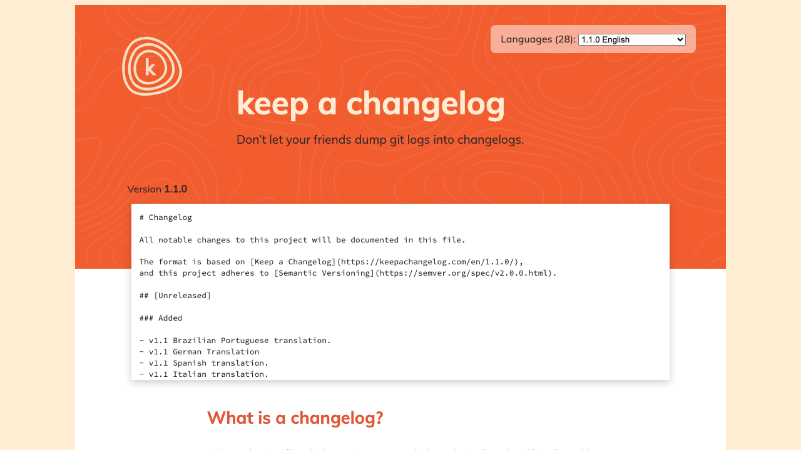

Claude Code published 20 releases between October 18 and November 16, and its [changelog](https://code.claude.com/docs/en/changelog) lists 1,807 entries for them, about sixty a day. An entry among them tells people who use fast mode on Opus 4.8 that their requests will start returning errors after November 30.

A changelog that developers read has to make that entry findable by someone who will never read the other 1,806. Writing a changelog means recording each change so that a person can assess an upgrade from it, and at this release rate the person gets there by searching the file or by asking a tool that read it for them.

## How much changelog can one person read?

Far less than a fast-moving project now publishes. The count for the thirty days to November 16 comes from a short script.

```python
"""Count releases and entries in the Claude Code changelog over a 30-day window."""
import datetime
import re
import sys
import urllib.request

url = "https://code.claude.com/docs/en/changelog.md"
request = urllib.request.Request(url, headers={"User-Agent": "Mozilla/5.0"})
text = urllib.request.urlopen(request, timeout=60).read().decode("utf-8")

end = datetime.date(2026, 11, 16)
start = end - datetime.timedelta(days=29)
release = re.compile(r"^\*\*(\d+\.\d+\.\d+)\*\*\s+(\w+ \d+, \d{4})\s*$", re.M)
matches = list(release.finditer(text))

releases = entries = flagged = 0
labels = {}
for i, match in enumerate(matches):
    day = datetime.datetime.strptime(match.group(2), "%B %d, %Y").date()
    if not start <= day <= end:
        continue
    body = text[match.end(): matches[i + 1].start() if i + 1 < len(matches) else len(text)]
    releases += 1
    for line in body.splitlines():
        label = re.match(r"^\*\*([A-Z][a-z ]+)\*\*$", line.strip())
        if label:
            labels[label.group(1)] = labels.get(label.group(1), 0) + 1
        if line.lstrip().startswith("* "):
            entries += 1
            if re.match(r"\* (\\\[[^]]+\] )?(Deprecated|Removed) ", line.lstrip()):
                flagged += 1

print(f"window: {start} to {end}")
print(f"releases: {releases}")
print(f"entries: {entries}  ({entries / releases:.1f} per release, {entries / 30:.1f} per day)")
print(f"entries that open with Deprecated or Removed: {flagged}")
print("section labels used:", ", ".join(f"{k} x{v}" for k, v in sorted(labels.items(), key=lambda kv: -kv[1])))
```

Its totals for the month, from `python3 changelog_stats.py`:

```text
window: 2026-10-18 to 2026-11-16
releases: 20
entries: 1807  (90.3 per release, 60.2 per day)
entries that open with Deprecated or Removed: 11
section labels used: Added x16, Changed x16, Improved x1
```

The project knows nobody reads all of it. The page describes itself as generated from the CHANGELOG.md file in the project's GitHub repository, and says "Longer releases are grouped by type of change, with long lists of improvements and bug fixes collapsed."

[Keep a Changelog](https://keepachangelog.com/en/1.1.0/), the format that page loosely follows, opens its principles with "Changelogs are for humans, not machines." I think that is still right about who makes the upgrade decision and out of date about who reads first.

Fern's [State of Docs report](https://buildwithfern.com/post/state-of-docs) from November 10 says of the changelog that "Agents read it twice as much as people to understand what's changed on your platform." That figure comes from the docs sites Fern hosts, and I looked at how it was counted in [a separate essay](/articles/agents-reading-docs/).

The fast mode entry shows what survives being read by search.

"Deprecated fast mode for Opus 4.8 as of October 30, 2026; it will be removed on November 30, 2026. After removal, fast mode requests on Opus 4.8 return an error and do not fall back to standard Opus 4.8."

It names the feature, gives both dates and states the failure a user will see, so it makes sense with nothing around it. It sits in a list headed "Changed", though, and the script found only eleven entries in the month that open with the word Deprecated or Removed, none of them under a heading of their own.

## Start with the upgrade decision

The version and date come first, and breaking changes and required action sit above everything else in the entry. A developer shouldn’t have to infer the risk from the eighth bullet.

The beginning of a release entry should answer:

- What version shipped, and when?
- Is the release compatible with the previous version?
- Which users, APIs, or environments are affected?
- Is action required before or after upgrading?
- Where are the migration instructions?

“Updated authentication handler” answers none of those questions. “Expired access tokens are now rejected immediately, so remove any client-side grace-period logic before upgrading” tells the reader what changed and why it matters.

### Write the consequence before the implementation

Internally, the change may be a refactor, a new cache, or a renamed class. From the user’s side, it might mean a faster response, a changed error, or nothing observable at all.

Lead with the consequence and include implementation detail only when it helps someone diagnose or adapt. The project log becomes a product record.

### Make required action impossible to miss

Use a consistent label for breaking changes and required migrations. A generic “Changed” heading is too quiet for work that can break an integration.

> **Breaking:** `client.retryCount` has been replaced by `client.retry.maxAttempts`. Rename the field before upgrading or the client will fall back to its default retry limit.

The label catches attention, while the second sentence gives a consequence and a next step. A link can carry the full migration procedure.

## Use one repeatable release structure

[Keep a Changelog](https://keepachangelog.com/en/1.1.0/) recommends a human-readable file with releases in reverse chronological order, ISO-formatted dates, and consistent categories. Its Unreleased section captures changes before release day.

Its categories are simple because they map to the questions developers ask:

| Category | What the reader learns |
|---|---|
| Added | Which new capability is available |
| Changed | Which existing behavior now works differently |
| Deprecated | What to stop using before it is removed |
| Removed | What no longer exists |
| Fixed | Which known behavior is corrected |
| Security | Which security exposure or hardening matters |

You don’t have to force an empty heading into every release. Keep the vocabulary consistent and use only the categories that have something meaningful in them.

<div class="visual-wrapper">
  <div class="visual-title">The Keep a Changelog structure</div>
  <div class="visual-container">
    
  </div>
</div>
<p class="visual-caption">Versions, dates, and change types make the file predictable for someone assessing a release. The Git history can remain in Git.</p>

### Keep an Unreleased section

An Unreleased section is the working area for changes that users will eventually need to understand. Contributors can add an entry with the product change while reviewers still remember the impact.

At release time, move those entries under a version and date. The release process becomes an editorial pass through material that already has context.

### Mark yanked releases without erasing them

If a release is withdrawn, keep its entry and mark it as yanked. Explain why it should not be used and which version contains the fix or replacement.

Deleting the entry leaves anyone who already installed that version with no record of it. A changelog is a record, including when the record is uncomfortable.

## Make the version number agree with the prose

[Semantic Versioning](https://semver.org/) communicates the compatibility promise through `MAJOR.MINOR.PATCH`. A major version contains incompatible API changes, a minor version adds backward-compatible functionality, and a patch contains backward-compatible fixes.

The changelog must make the same promise. A breaking configuration change described inside a patch release creates more confusion than precise prose can repair.

### Treat deprecation as a sequence

A deprecation entry needs four facts, which are the feature, its replacement, the removal date and the migration. The fast mode entry quoted above has all four, ending "Migrate to Opus 5.5 to keep the speedup".

Repeat the warning in later releases as the removal date approaches.

When the feature is removed, link back to the first deprecation entry. The sequence gives users evidence that the change was announced and time to act.

### Describe compatibility in plain language

Spell out whether existing code continues to work, even when the version number already signals compatibility. Name any exception beside that statement.

For example:

> This release is backward compatible for REST API users. The JavaScript SDK now requires Node.js 20 or later.

Compare that with “runtime support modernized,” which leaves the compatibility question unanswered. Precision builds trust faster than polish.

## Write entries around user impact

Brief works when it remains specific. Behavior, affected user, and action give you enough structure without turning each entry into a mini article.

### Rewrite vague entries

| Weak entry | Useful entry |
|---|---|
| Improved retries | The client now retries `429` responses up to 4 times with exponential backoff; disable this with `retry.maxAttempts: 0`. |
| Fixed login bug | Fixed OAuth login failures for accounts whose email address contains a plus sign. |
| Updated pagination | List endpoints now return a cursor in `next_page`; integrations using numeric page offsets must migrate before v4. |
| Security improvements | Requests with invalid webhook signatures now return `401` before the handler processes them. |

The rewritten entries let readers decide whether the change applies to them. They also contain the option, endpoint, error code, or environment someone is likely to search for later.

### Add links that finish the job

The changelog points readers to the migration guide, updated reference page, security advisory, or issue when they need more detail. Keep the release entry focused on the decision at hand.

Use descriptive link text so the destination is clear out of context. “Migrate from numeric pagination to cursors” is stronger than “learn more.”

<figure class="np-figure">
  <a class="np-figure-zoom" href="/static/images/diagrams/writing-changelogs/entry-anatomy.svg"><picture><source media="(max-width: 712px)" srcset="/static/images/diagrams/writing-changelogs/entry-anatomy.narrow.svg" width="288" height="720"></picture></a>
  <figcaption>A strong entry exposes version, date, category, impact, and migration path in layers. A reader can stop after the first useful answer or continue into the details.</figcaption>
</figure>

## Make the changelog part of the release workflow

If the changelog is assembled during a quarterly cleanup, half the context is already gone. Capture the impact as the code changes, when the tradeoffs are still fresh.

### Add an entry with the pull request

Ask contributors to add an Unreleased entry when a change affects documented behavior. The reviewer can then compare the code, documentation, and changelog claim in the same context.

Not every commit deserves an entry. Internal refactors, test changes, and dependency updates belong only when users see a consequence.

### Automate collection, not judgment

GitHub can create [automatically generated release notes](https://docs.github.com/en/repositories/releasing-projects-on-github/automatically-generated-release-notes) from merged pull requests and contributors. Labels and a `.github/release.yml` file can organize or exclude entries.

Generated notes provide raw material. An editor still has to find migration work, combine duplicates, rewrite internal titles, and move risk to the top.

### Give the file an owner

The release manager can own completeness, while technical writers or developer advocates own clarity and links. Product engineers should verify the technical claim for changes they implemented.

Ownership should be visible in the release checklist. “Someone will update the changelog” is how the task moves to the final hour and turns into copied pull request titles.

## Changelog checklist

- The version and date are correct.
- Releases appear newest first.
- Breaking changes and required actions are visible before routine improvements.
- Each entry describes observable impact.
- Deprecated and removed features include alternatives.
- Security entries are specific without exposing unsafe detail.
- Migration, reference, and advisory links resolve.
- The version number matches the compatibility claim.
- The Unreleased section remains ready for the next change.

Scan the rendered page using only headings, labels, and the first line of each bullet. If the upgrade risk is still unclear, the hierarchy needs another pass.

## Worked example: turn pull requests into a release entry

Suppose a release contains these merged pull requests:

```text
#842 Refactor cursor helper
#847 Add max page size validation
#851 Update Node matrix
#856 Retry webhook delivery
#861 Remove legacy page parameter
#864 Fix email normalization
```

Copying those titles would be quick and almost useless. The list does not say that pagination is breaking, Node.js support changed, or webhook deliveries now behave differently.

### Gather the missing facts

Before writing, ask the owners for the behavior behind each change:

| Pull request | User-facing fact |
|---|---|
| Cursor helper and legacy parameter | `page` is removed; list endpoints accept `cursor` only |
| Page size validation | Requests above 100 items return `400`; the API no longer silently caps them. |
| Node matrix | Node.js 18 support is removed; Node.js 20 is the minimum |
| Webhook retry | Failed deliveries retry 4 times over 15 minutes |
| Email normalization | Login now accepts uppercase characters in email addresses |

The cursor helper and removed parameter form one breaking pagination change. The refactor disappears because users cannot observe it.

### Write the scannable version

The resulting entry could read:

```markdown
## [4.0.0] - 2026-07-30

### Breaking

- List endpoints no longer accept the `page` parameter. Replace numeric
  pagination with `cursor`; see the [pagination migration guide].
- The JavaScript SDK now requires Node.js 20 or later. Upgrade the runtime
  before installing version 4.

### Changed

- List requests with `limit` values above 100 now return `400
  invalid_page_size`. Previous versions silently reduced the value to 100.
- Failed webhook deliveries now retry 4 times over 15 minutes. Endpoints
  may receive the same event more than once, so handlers must remain idempotent.

### Fixed

- Email login now treats the domain and local-part casing consistently, fixing
  failures for addresses entered with uppercase characters.
```

The breaking changes appear before routine behavior, and every bullet names a field, limit, runtime, error, or action. A developer can recognize their integration without opening the pull requests.

### Link to the work that cannot fit

The pagination bullet should link to a migration page containing before-and-after requests:

```http
GET /v3/orders?page=3&limit=50
```

```http
GET /v4/orders?cursor=eyJpZCI6IjEwMDAifQ==&limit=50
```

The migration page can explain cursor storage, ordering, and expiry. The changelog identifies the change and sends the affected reader there.

### Check the release against its version

Removing an input and a supported runtime warrants a major version under Semantic Versioning. Calling the release `3.8.2` would contradict the compatibility promise before anyone reads the notes.

Either preserve compatibility or change the version. A note cannot turn a breaking patch into a safe patch.

### Preserve the history after a correction

Suppose the release later proves that webhook retries can happen over 20 minutes. Correct the entry and record the clarification in the next release so readers can see the change.

Readers need the canonical page to become accurate, but teams also need an audit trail when the published behavior changed. A repository commit provides that trail, and the next changelog entry makes the correction visible to people who do not watch the file.

A changelog records the durable sequence, while [release notes explain one release decision](/articles/writing-release-notes/) in enough depth for a developer to act. When several supported versions remain live, preserve the routes to their instructions.

## Changelog FAQ

**What is the difference between a changelog and release notes?**

A changelog is the durable, chronological record of product changes across versions. Release notes can provide a richer explanation for one release, including context, screenshots, migration guidance, and rollout information.

**Should every commit appear in a changelog?**

No. Include changes that affect user-visible behavior, compatibility, security, supported environments, or documented workflows.

**Where should a changelog live?**

Keep a `CHANGELOG.md` file in the repository when developers consume the project from source or package registries. You can also render it on the documentation site, but both views should come from one canonical source.

**How detailed should a changelog entry be?**

Give enough detail to identify who is affected, what changed, and whether action is required. Link to a dedicated guide when safe migration needs several steps or substantial code.

**Can generated release notes replace a changelog?**

They can collect merged work, but they cannot reliably explain user impact. Use automation to assemble candidates and human review to produce the actual record.
