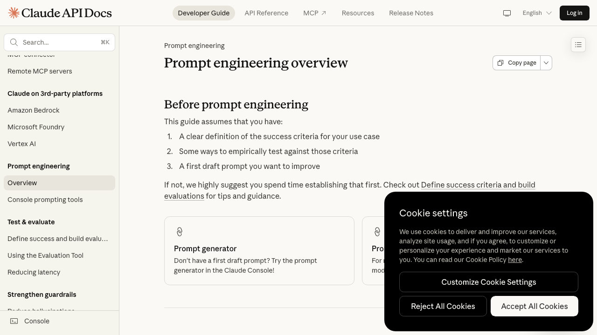

A thread on Hacker News on November 8 gathered user reports that Claude Opus 5.5 had been "nerfed", and the reply that stayed with me asked a documentation question: ["Do you run evals as a matter of course?"](https://news.ycombinator.com/item?id=50420515) The commenter went on to say that "without any measurement it's a non-interesting assertion", while allowing that labs do sometimes downgrade a model.

Technical writing for AI products exists to make that argument answerable. A reader of ordinary API docs needs to know what a call returns, and a reader of AI product docs also needs to know what stays fixed behind a model name and how to check it.

## What does a model name promise in the docs?

It promises only what the page says it does, so the page has to say. OpenAI's [prompt engineering guide](https://developers.openai.com/api/docs/guides/prompt-engineering) is direct about the risk: "Even different snapshots of models within the same family could produce different results."

  
OpenAI Prompt Engineering Guide

  

    
  

  
Anthropic Prompt Engineering Guide

  

    
  

The same guide recommends "Pinning your production applications to specific model snapshots", and tests that "measure prompt behavior". Both OpenAI and Anthropic publish prompt engineering guides, pictured above, and both treat the model version as part of the instruction.

That gives the writer a rule for every page with a model identifier on it. State whether the identifier is a snapshot or a moving alias, and give the date the example was last run against it.

Retirement dates belong in the docs too. Anthropic's [model deprecations page](https://platform.claude.com/docs/en/about-claude/model-deprecations) commits to "at least 60 days' notice before model retirement for publicly released models", and my post on [writing a changelog](/articles/writing-changelogs/) looks at one deprecation entry that carries its dates and its failure mode in two sentences.

## What is the output contract of an AI feature?

It is the schema the output follows, the cases where it won't, and what the caller has to check itself. OpenAI's structured outputs guide puts all of that in two sentences, which I hold up as the model for any AI reference page.

"Structured Outputs constrains completed, non-refusal model output to your supplied JSON Schema. Your application still needs to handle refusals, incomplete responses, and API errors, and validate any business rules that the schema does not express."

A writer working from that standard documents which fields the schema guarantees and how a refusal arrives. My guide to [structured outputs](/articles/llm-structured-outputs/) goes through those cases for each vendor.

<figure class="np-figure">
  <a class="np-figure-zoom" href="/static/images/diagrams/writing-for-ai-products/example-pattern.svg"><picture><source media="(max-width: 712px)" srcset="/static/images/diagrams/writing-for-ai-products/example-pattern.narrow.svg" width="288" height="720"></picture></a>
  <figcaption>Show the request, the contract, a refusal, and the caveat. Anything less demos well and deploys badly.</figcaption>
</figure>

The pattern in the figure is the smallest complete example for an AI endpoint. It has the request, the contract, one refusal and the caveat that changes how the caller builds.

## What makes a code sample trustworthy in AI docs?

It runs, its output is shown, and the page says which model produced that output.

Google's [technical writing course](https://developers.google.com/tech-writing/two/sample-code) sets the base requirement for any sample: "Build without errors. Perform the task it claims to perform."

An AI sample needs one thing more, because the same code returns different text next quarter. Print the output the sample produced, with the model snapshot and the date, so a reader whose result differs can tell a changed model from a broken integration.

That is also the answer to the thread I opened with. A docs page that ships a small eval, a handful of prompts with expected properties, gives every user the measurement the commenter asked for.

## Who reads AI product docs besides developers?

Coding agents and retrieval systems read them, a paragraph at a time and without the surrounding page. A sentence such as "rate limits apply" sends a person to look up the number, and gives a coding assistant nothing to put in the client it is generating.

Writing for that reader means stating defaults and limits in the sentence where they matter, and showing the exact shape of an error. I looked at how much of docs traffic is agents in [a separate essay](/articles/agents-reading-docs/), and the [agent harnesses](/articles/agent-harnesses/) post covers the runtime that feeds those pages to a model.

## How I would evaluate a technical writer for an AI company

Ask for evidence in five areas before looking at a general portfolio.

1. A prompt or system instruction documented with the precision of an API method.
2. A JSON schema explained with its refusal case and its validation boundary.
3. An example complete enough to run, with its output and model version shown.
4. A migration note for a model change that says what will behave differently.
5. A record of getting the real contract from engineers, in place of a paraphrase of the launch brief.

A further quality rarely appears in a job description, which is judgment about what to leave out. Strong AI writing omits guarantees the product can't keep and states uncertainty where the behavior is experimental.

My page as a [freelance technical writer for AI companies](/services/freelance-technical-writer-for-ai-companies/) links the work I've published for Firecrawl and OpenComputer, along with the Centus guides. [My work page](/work/) has the case studies.

## FAQ

**How is technical writing for AI products different from ordinary API documentation?**

AI docs still need reference accuracy, and they also have to document behavior. That covers prompts, schemas, refusals, model versions and the evidence that an example was run.

**Should a technical writer for an AI company know how to run evals?**

Yes, at a practical level. A writer who can't read eval output can't say accurately what changed between two model versions.

**Do AI product docs need more tutorials or more reference pages?**

Reference quality breaks first. Parameter defaults, schema guarantees and refusal handling are the details teams skip, and they are the ones an integration depends on.

**Should writers own prompt libraries and system prompts?**

Shared ownership works best. Engineering owns runtime behavior, and writers own clarity and upgrade notes, which requires that writers can see the real prompts.

**What is the fastest way to tell whether an AI writer is strong?**

Ask them to rewrite one weak API page for an LLM feature, and give them the schema, a prompt template and a model upgrade note. A strong writer's version gets more specific.
