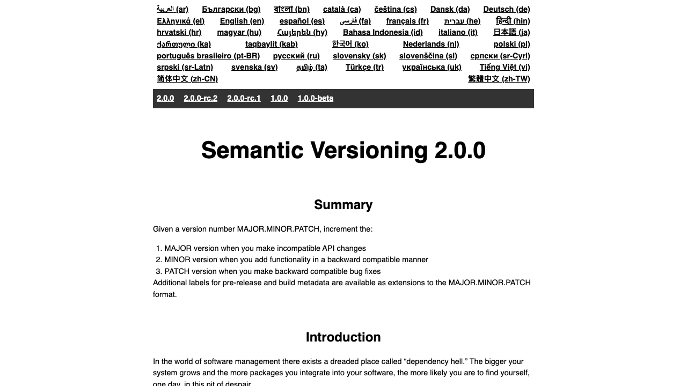

OpenSSH 10.6p2, released on November 5, contains what [its own release notes](https://www.openssh.org/releasenotes.html) call "a critical security workaround", and a reader is 427 words into those notes before learning it. GitLab's [critical patch release](https://docs.gitlab.com/releases/patches/patch-release-gitlab-19-5-1-released/) of October 21 says who has to upgrade within 32 words.

Writing release notes that developers trust comes down to that distance. Someone opening the notes is deciding whether to upgrade and what it will cost, so the page has to answer that decision before it describes the release.

## How soon do real release notes say who is affected?

The notes I looked at ranged from 32 words to 427, counted from the release line to the first sentence that names affected users.

```python
"""Count the words a reader passes before a release note says who must act."""
import html
import re
import urllib.request

notes = [
    ("GitLab 19.5.1 (Oct 21)", "https://docs.gitlab.com/releases/patches/patch-release-gitlab-19-5-1-released/",
     "On October 21, 2026, we released", "we strongly recommend that all self-managed"),
    ("Ghostty 1.4.0 (Oct 27)", "https://ghostty.org/docs/install/release-notes/1-4-0",
     "Release notes for Ghostty 1.4.0", "Paste protection didn't treat"),
    ("OpenSSH 10.6p2 (Nov 5)", "https://www.openssh.org/releasenotes.html",
     "Portable OpenSSH 10.6p2 was released", "This release contains a critical security workaround"),
]

for name, url, start, warning in notes:
    request = urllib.request.Request(url, headers={"User-Agent": "Mozilla/5.0"})
    page = urllib.request.urlopen(request, timeout=60).read().decode("utf-8", "replace")
    page = re.sub(r"(?is)<(script|style)[^>]*>.*?</\1>", " ", page)
    text = html.unescape(re.sub(r"<[^>]+>", " ", page)).replace("’", "'")
    begin = text.index(start)
    words = len(text[begin:text.index(warning, begin)].split())
    print(f"{name:<24} {words:>4} words before the first sentence about who is affected")
```

Saved as `first_warning.py`, it reports the distance for each note.

```text
GitLab 19.5.1 (Oct 21)     32 words before the first sentence about who is affected
Ghostty 1.4.0 (Oct 27)    144 words before the first sentence about who is affected
OpenSSH 10.6p2 (Nov 5)    427 words before the first sentence about who is affected
```

GitLab's opening is the model. Its second sentence says "we strongly recommend that all self-managed GitLab installations be upgraded to one of these versions immediately", and the third tells everyone else to stand down: "GitLab.com is already running the patched version."

[Ghostty 1.4.0](https://ghostty.org/docs/install/release-notes/1-4-0), released on October 27, spends its first 144 words on a summary and thanks, then lists security advisories ahead of any feature. Each advisory states what an attack needs, in sentences such as "This requires user interaction (copy-paste) to trigger." and "This affects Ghostty 1.3.0 and 1.3.1."

The OpenSSH sentence is precise once you reach it, naming "Linux systems that use the musl libc and PAM disabled". It sits below a donations paragraph and a deprecation notice, in the order the project's notes always use.

That order matters more as releases speed up. Since the 10.5 release in August the notes have opened with a paragraph on security reports found with AI tools, which says the team will be "making more frequent releases to get bugfixes into users' hands", and a project that ships more often asks its users to make the upgrade decision more often.

## Release notes and changelogs do different jobs

If you look at the two side by side, the changelog is the chronological record across versions. Release notes slow down on one release and explain its value, impact, and migration work.

The two can share source material without becoming the same document.

| Changelog | Release notes |
|---|---|
| Covers many versions | Focuses on one release |
| Uses concise categorized entries | Adds context, examples, and migration guidance |
| Optimized for lookup | Optimized for an upgrade decision |
| Usually maintained as a continuous file | Published as a versioned page or release |

[GitHub's releases documentation](https://docs.github.com/en/repositories/releasing-projects-on-github/about-releases) connects releases to Git tags, notes, and downloadable assets. That versioned artifact is the anchor a developer needs, while the prose explains what the artifact changes.

### Keep launch copy out of the risk summary

A launch post can tell a story about the problem, market, and product direction. Release notes should first identify observable behavior and affected users.

“Our fastest release yet” has no operational meaning. “Batch exports now finish up to 30 minutes after creation and send a webhook when the file is ready” describes behavior a developer can design around.

> If a sentence cannot help someone decide, migrate, verify, or troubleshoot, it does not belong above the technical changes.

## Put upgrade risk on the first screen

The opening should feel more like a status panel. You shouldn’t have to inspect every feature section to discover a runtime requirement or removed option.

### Name five things immediately

Lead with:

1. **Version and release date**
2. **Compatibility statement**
3. **Affected products, APIs, SDKs, or environments**
4. **Required action and deadline**
5. **Links to migration and rollback instructions**

A compact summary can look like this:

```text
Version:        4.0.0, 30 July 2026
Compatibility:  Breaking changes in authentication and pagination
Affected:       REST API and JavaScript SDK users
Action:         Migrate before 30 September 2026
Rollback:       v3 remains supported until the migration deadline
```

The block sets the reading order. Migration details still follow, but nobody has to discover the risk halfway down the page.

### Say who is not affected

Scope reduces unnecessary alarm. If a change affects only self-hosted deployments, say that cloud customers do not need to act, as GitLab's patch release does in its opening lines.

Negative scope is especially useful when a product has several SDKs, API versions, regions, or deployment models. It prevents every customer from interpreting a broad warning as their own emergency.

## Write what changed for the user

Pull request titles make sense from the team’s side of the work. Release notes have to turn them around and show what changed for the person using the product.

### Turn internal changes into decisions

| Internal language | Release-note language |
|---|---|
| Refactored token validation | Expired tokens now return `401` immediately; clients that relied on the previous grace period must refresh sooner. |
| Added queue backpressure | Requests above the queue limit now return `429` with a `Retry-After` header. |
| Upgraded database driver | No application change is required, but self-hosted deployments now require PostgreSQL 15 or later. |
| Fixed CSV bug | CSV exports now preserve leading zeroes in string columns such as postal codes. |

The right-hand column lets a developer recognize their system and choose an action. Concrete terms such as the error code and the field name also let a search find the entry later.

### Separate breaking changes from new capability

Put migration work before the feature tour. Breaking changes, deprecations, security impact, and supported-environment changes need their own section.

Within that section, use the same order for every item:

- Previous behavior
- New behavior
- Affected users
- Required change
- Verification step
- Rollback or support path

Consistency lets a reader scan long notes.

### Be precise about security

Say which versions are affected and what users should do, and link the advisory.

The Ghostty notes above do it in one line per advisory, and GitLab's add a warning a version number can't carry: "upgrading GitLab is not sufficient: you must also upgrade Ruby" for installations that bring their own runtime. Avoid vague phrases such as “security improvements,” because they tell a reader neither the urgency nor the scope.

Coordinate security wording with the security owner and link to the canonical advisory for updates. Leave out exploit detail that creates additional risk.

## Show the changed behavior

Visuals help when they make a changed state or workflow quicker to understand. A focused before-and-after can do that, but a decorative dashboard screenshot usually can’t.

### Use before-and-after examples

For an API change, a focused request or response diff is usually better than a full screenshot:

```diff
- { "next_page": 3 }
+ { "next_cursor": "eyJpZCI6IjEwMDAifQ==" }
```

For an interface change, crop the screenshot to the changed region and call out the control or state the reader needs to notice. The caption should explain the consequence.

### Skip visuals for routine inventory

A decorative dashboard screenshot does not explain a dependency update. It adds page weight and another asset that can become stale.

Ask whether the visual helps someone migrate or verify behavior, and leave it out if it does neither.

## Let the version and prose make the same promise

[Semantic Versioning](https://semver.org/) uses `MAJOR.MINOR.PATCH` to signal compatibility. Major releases contain incompatible API changes, minor releases add backward-compatible functionality, and patch releases contain backward-compatible fixes.

The notes have to agree with the version. A breaking runtime change inside a patch release makes both signals unreliable.

<div class="visual-wrapper">
  <div class="visual-title">Semantic Versioning at a glance</div>
  <div class="visual-container">
    
  </div>
</div>
<p class="visual-caption">The version number is the first compatibility signal. Release notes must explain that signal and disclose any narrower exception that the number cannot express.</p>

### Explain support windows with dates

State the first version that deprecates the behavior, the expected removal version, and a calendar date when possible. “Deprecated soon” leaves the migration schedule open-ended.

If the schedule changes, update the canonical release page and link later notes back to it.

### Include rollback limits

If a database migration, state change, or new file format prevents a clean downgrade, say so before the upgrade steps. A rollback instruction that no longer works is worse than no instruction because it creates false confidence.

State what can be reversed and which data needs a backup, with the date support for the previous version ends.

## Automate collection, keep judgment human

Release tooling can already collect pull requests, contributors, labels, and links. GitHub's [automatically generated release notes](https://docs.github.com/en/repositories/releasing-projects-on-github/automatically-generated-release-notes) can even use `.github/release.yml` to define categories and exclusions.

Automation saves collection time, but the inventory remains a draft. It cannot reliably combine several pull requests into one user-facing change or spot migration work behind an innocent title.

Ghostty's maintainers went the other way and say so in the notes: "They take a combined 16+ hours to write". That is the cost of the judgment, and a generated inventory doesn't remove it.

My essay on [what a written-by-a-human label proves](/articles/written-by-a-human/) starts from a line like theirs.

### Build the notes during development

Ask the author of a user-visible change to record:

- The previous and new behavior
- The affected user or environment
- Compatibility and migration impact
- Documentation that must change
- A verification or test result
- Screenshots or examples when behavior is visual

Capture this in the pull request or an Unreleased entry while the details are current. The release editor can organize and simplify the existing context.

### Give one editor the full page

Individual engineers can verify their sections, but one person should edit the complete release for hierarchy, duplicate entries, tone, and missing links. Without that pass, the notes read like several teams pasted their sprint summaries together.

Edit from highest risk to lowest risk: breaking changes, security and support changes, fixes, new capability, and minor improvements.

## What order should release notes follow?

Release notes should run from the decision to the detail. The labels can change, and the order below should stay the same from one release to the next.

1. **Release summary:** version, date, compatibility, scope, and action.
2. **Breaking changes:** migration, verification, deadline, and rollback.
3. **Security and support:** advisories, runtime requirements, and end-of-support dates.
4. **Fixes:** corrected behavior and affected users.
5. **New capabilities:** what is available and how to try it.
6. **Known issues:** symptoms, workarounds, and tracking links.
7. **Resources:** migration guide, reference changes, assets, and support.

The [release notes template](/articles/release-notes-template/) turns this order into a copyable Markdown file with a checker that fails a note missing its rollback line.

<figure class="np-figure">
  <a class="np-figure-zoom" href="/static/images/diagrams/writing-release-notes/release-layers.svg"><picture><source media="(max-width: 712px)" srcset="/static/images/diagrams/writing-release-notes/release-layers.narrow.svg" width="288" height="992"></picture></a>
  <figcaption>The page should reveal information in layers: decision first, impact second, and implementation detail last. Readers can stop when they have enough evidence.</figcaption>
</figure>

### Final trust check

- Can a developer identify upgrade risk from the first screen?
- Are affected and unaffected users both clear?
- Does every breaking change include an action and verification step?
- Do the version number and compatibility claim agree?
- Does every deadline include a calendar date?
- Are screenshots current and necessary?
- Do migration, advisory, rollback, and reference links work?
- Can someone find the same release again by version?

## Worked example: write the notes for a breaking SDK release

Take a hypothetical `4.0.0` release of an SDK, with a [changelog](/articles/writing-changelogs/) kept alongside it. The changelog records pagination, runtime, webhook retry, validation, and login changes in compact form.

Release notes turn that record into an upgrade plan. They need more context than the changelog, especially around order, verification, and rollback.

### Open with the decision

The first screen could read:

```text
SDK 4.0.0, 30 July 2026

Upgrade effort: Medium
Compatibility: Breaking changes to pagination and Node.js support
Affected: JavaScript SDK users and REST integrations using `page`
Deadline: Version 3 security support ends 30 September 2026
Action: Upgrade to Node.js 20 and migrate list endpoints to cursors
Rollback: Safe until the first v4 cursor is stored; see rollback limits
```

“Medium” is only useful because the following fields explain it.

### Explain the migration in dependency order

Runtime comes before package installation, and package installation comes before code changes. Put the migration steps in that order:

1. Confirm that development, CI, and production run Node.js 20 or later.
2. Upgrade the SDK in a branch and run the existing integration tests.
3. Replace numeric `page` parameters with the returned `next_cursor`.
4. Make webhook handlers idempotent before enabling the new retry behavior.
5. Deploy to a test environment and compare pagination results.
6. Roll out gradually while monitoring `400` and `401` responses.

The dependency order gives the reader one safe path across several product changes.

### Show the change where prose is weak

The pagination section should include a focused before-and-after:

```diff
- const orders = await client.orders.list({ page: 3, limit: 50 });
+ const orders = await client.orders.list({ cursor, limit: 50 });
+ cursor = orders.nextCursor;
```

Then explain the behavior prose cannot show:

- Cursors follow creation-time order.
- A cursor is valid for 24 hours.
- Changing filters invalidates the previous cursor.
- The SDK returns `nextCursor: null` on the final page.

### State the rollback boundary

Suppose version 4 cursors cannot be passed to version 3. The notes should say that rolling back the SDK is safe only before the application persists or exposes a v4 cursor.

A practical rollback block might say:

> Keep version 3 deployed in the previous production slot. If error rates rise before v4 cursors are stored, shift traffic back. After that point, disable pagination writes and contact support before downgrading.

An explicit rollback boundary may prompt the engineering team to add a compatibility layer. Finding that risk before release leaves time to reduce it.

### Separate known issues from migration work

If the release has a known issue with cursors on empty filtered results, give it a visible section:

```text
Known issue: A filtered list with zero results can return an empty string
for `nextCursor`; the expected value is `null`.

Workaround: Treat both values as the end of the list.
Tracking: SDK-917
Fixed in: Planned for 4.0.1
```

Give this its own Known issues section. Include a searchable symptom, workaround, tracking reference, and expected resolution.

### Finish with verification

The release note should leave the reader with checks they can run:

- CI and production report Node.js 20 or later.
- The application no longer sends a numeric `page` parameter.
- A full pagination test returns every record exactly once.
- Duplicate webhook delivery does not create duplicate work.
- Monitoring shows no unexplained increase in `400`, `401`, or `429` responses.

## FAQ

**Who writes release notes?**

Someone who knows what the release changes for its users, with engineers checking the sections they own. Ghostty's 1.4.0 notes were written by its maintainers, who put the cost at more than 16 hours.

**How long should release notes be?**

Use as much space as the upgrade decision requires, then stop. A small patch may need five precise bullets, while a major version may need a summary plus a separate migration guide.

**Should release notes include every pull request?**

No. Include work that changes user-visible behavior, compatibility, security, supported environments, or documented workflows.

**Where should release notes be published?**

Publish them at a stable, versioned URL that developers can search and link to. You can mirror a concise version in GitHub Releases or a package registry, but keep one canonical page.

**What makes release notes trustworthy?**

Consistent disclosure of impact, required action, deadlines, and known limitations. Developers trust notes when past releases helped them upgrade without surprises.

**Can AI write release notes from commit history?**

AI can cluster changes and produce a first draft, but commit history rarely contains complete user impact or migration context. A person who understands the release must verify compatibility, scope, security wording, and every required action.
