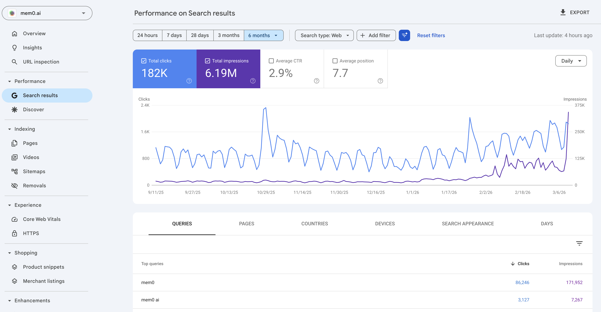

## Technical content management at scale

I joined Mem0 in February 2026 with clear instructions to professionalize the content operation and scale organic traffic. Weekly traffic sat at roughly 6,000 visits when I arrived, totaling 24,000 monthly visits. April data showed that traffic climbed to about 45,000 monthly visits, a 50% increase driven by technical depth and workflow efficiency.

## Leading a team of 13 writers without technical bottlenecks

Managing a distributed team of 13 writers required end-to-end operational ownership. I handled hiring, vetting, and technical reviews to ensure every guide met engineering standards. Hiring writers capable of understanding vector embeddings and KV cache eviction ensured that drafts were accurate before they reached the publishing stage. Automation layers simplified the handoff between writers and editors while managing the administrative burden of invoices and resource allocation.

Operational ownership removed the management tax from the engineering team. Standardized technical reviews ensured that drafts reached production without structural corrections or broken code paths. Results were driven by a data-driven calendar targeting high-intent keywords in the memory infrastructure space.

## Workflow automation as a growth multiplier

Scale fails when it depends on manual follow-ups. My role involved setting up custom internal tools to manage the 13-writer pipeline without technical bottlenecks. Administrative tasks like invoicing and editorial feedback loops were automated to maintain a high publishing velocity. Technical depth remained the primary focus while scaling output across multiple categories.

Management of the content operation included handling editors, invoicing, and resource allocation. Peer-to-peer engineering tones in the content ensured that we reached technical audiences that generic writers cannot replicate. Scaling your technical content program requires a combination of technical vetting, workflow automation, and leadership.

Running a program like this one is work I take on, described on my [technical content programs](/services/technical-content-programs/) page.

## What I wrote there

I wrote 11 of the blog's guides. Mem0 later changed the author shown on them or took them down, so each link goes to an archived copy that shows my byline.

- [The Architecture of Remembrance: Architectures, Vector Stores, and GraphRAG](https://web.archive.org/web/20260209224933/https://mem0.ai/blog/what-is-ai-agent-memory), posted on January 26, 2026
- [Natural Language Processing (NLP): The Complete Beginner's Guide](https://web.archive.org/web/20260216121127/https://mem0.ai/blog/what-is-natural-language-processing), posted on January 27, 2026
- [Prompt Engineering: The Complete Guide to Better AI Outputs](https://web.archive.org/web/20260209235826/https://mem0.ai/blog/prompt-engineering-complete-guide), posted on January 27, 2026
- [Add Persistent Memory to Claude Code with Mem0 (5-Minute Setup)](https://web.archive.org/web/20260307002643/https://mem0.ai/blog/claude-code-memory), posted on February 7, 2026
- [Short-Term vs Long-Term Memory in AI: How Engineers Design, Evaluate, and Scale Memory Systems](https://web.archive.org/web/20260307001240/https://mem0.ai/blog/short-term-vs-long-term-memory-in-ai), posted on February 9, 2026
- [AI Memory Security: Best Practices and Implementation](https://web.archive.org/web/20260307003813/https://mem0.ai/blog/ai-memory-security-best-practices), posted on February 11, 2026
- [Long-Term Memory for AI Agents: The What, Why and How](https://web.archive.org/web/20260307002936/https://mem0.ai/blog/long-term-memory-ai-agents), posted on February 21, 2026
- [Anthropic Claude Pricing: Subscription Plans and API Costs](https://web.archive.org/web/20260306231250/https://mem0.ai/blog/anthropic-claude-pricing), posted on February 22, 2026
- [Reducing Hallucinations in LLMs with Grounded Memory](https://web.archive.org/web/20260307004331/https://mem0.ai/blog/reducing-hallucinations-llms-with-grounded-memory), posted on February 24, 2026
- [Short-Term Memory for AI Agents: What, Why, and How?](https://web.archive.org/web/20260307002707/https://mem0.ai/blog/short-term-memory-for-ai-agents), posted on February 26, 2026
- [What Is Agentic RAG? How It Works and When to Use It](https://web.archive.org/web/20260311051406/https://mem0.ai/blog/what-is-agentic-rag), posted on March 10, 2026
