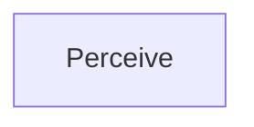

# Image brand pipeline

Renders article figures from Mermaid source into the ninadpathak.com image brand. [Pele](https://pele.run) lays out the diagram. `lib/plate.js` restyles Pele's SVG and composes the plate around it in headless Chromium, so text is measured with the real fonts. The rules live in [GUIDELINE.md](GUIDELINE.md).

```bash
cd tools/image-brand
npm ci                                   # pele 1.8.0, playwright-core, @fontsource fonts, subset-font
node og.mjs                              # share-card sources for every published post
node render.mjs                          # every content/diagrams/<slug>/<id>.mmd -> static/images/diagrams/<slug>/
node render.mjs ../../content/diagrams/agent-loop-anatomy/agent-loop.mmd   # one figure
node render.mjs --check                  # exit 1 if output is stale, contrast fails AA, a figure is over its word budget, or a source is invalid
node render.mjs --out /tmp/preview       # render somewhere else
PREV_DIR=/path/to/older/renders node review.mjs http://127.0.0.1:8791   # before/after (+ version-vs-version) sheets
```

Chromium comes from Playwright's browser cache (`npx playwright-core install chromium` if it is missing).

| File | Job |
|---|---|
| `brand.tokens.json` | Palette (light/dark, site token mapping), contrast pairs, type roles, strokes, radii, canvas sizes |
| `lib/tokens.mjs` | Loads tokens, checks WCAG contrast, reports drift from `static/css/main.css`, emits the Pele theme CSS |
| `theme/brand.css` | Element styles for plates and Pele classes, using only `--np-*` variables |
| `lib/source.mjs` | Parses `%% @directive` metadata, injects glyph placeholders, rejects removed v2 text components, counts words |
| `lib/glyphs.js` | Glyph library (GUIDELINE.md §7): tile and strip drawings, badges |
| `lib/plate.js` | In-browser brand layer: glyph nodes, orthogonal router, ring layout, motifs M1–M14 (§8), plate and share-card composition |
| `render.mjs` | CLI: render, embed WOFF2 font subsets, write SVG, PNG 2x light/dark, JSON sidecar with embed markup |
| `review.mjs` | Before/after sheets in live article pages |
| `og-cards.json`, `og.mjs` | Share-card glyph chain per post; writes the og.mmd sources; `--check` fails on a post without a card |
| `contact.mjs` | Contact sheet of every share card |
| `sweep.mjs` | Batch sweep: before (main) vs after (branch), plus 320/375/1366 × light/dark with overflow and load checks |

A source file is valid Mermaid. Directives sit in `%%` comments, which Mermaid ignores:



Determinism: the same sources, tokens, CSS, brand layer, Pele version, fonts, and Chromium build give byte-identical files. Each SVG records a hash of those inputs, and `--check` compares it.

Build integration: rendered files are committed, so `build.py` and Cloudflare Pages stay pure Python. CI (`.github/workflows/quality.yml`) runs `og.mjs --check` and `render.mjs --check`; `tests/test_image_brand.py` checks the built site's share-card tags and figure references.
